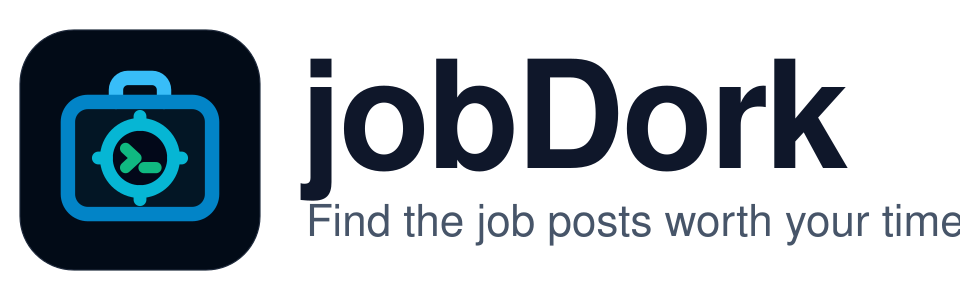
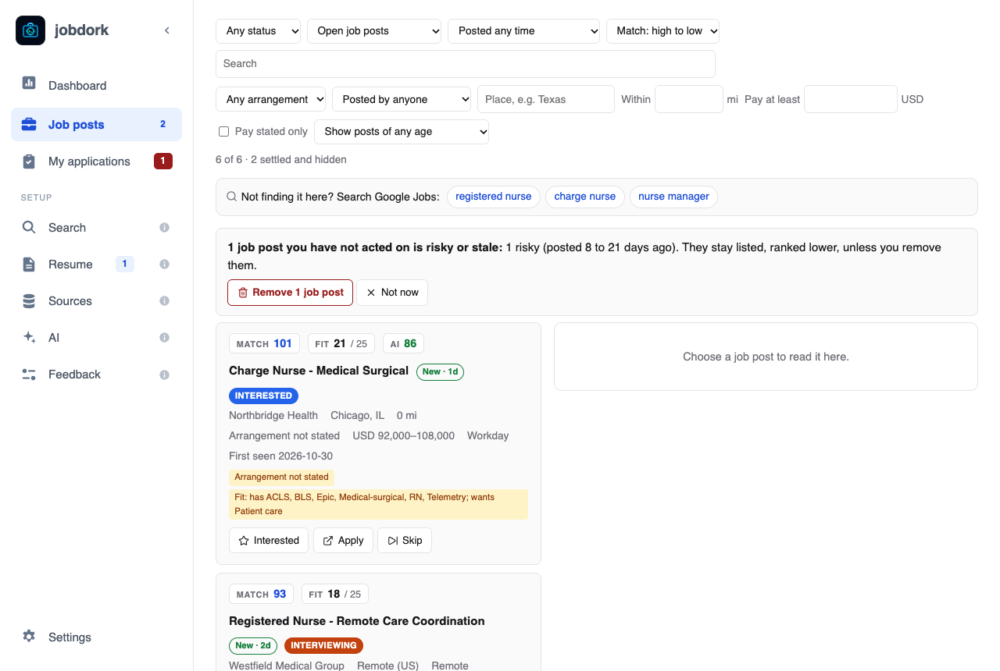

<p align="center">
  <picture>
    <source media="(prefers-color-scheme: dark)" srcset="docs/images/banner-dark.svg">
    
  </picture>
</p>

<hr>

<p align="center">
  <a href="https://github.com/jessn-dev/jobDork/actions/workflows/docker.yml"></a>
  <a href="https://github.com/jessn-dev/jobDork/actions/workflows/guide.yml"></a>
  <a href="SECURITY.md"></a>
  <a href="https://scorecard.dev/viewer/?uri=github.com/jessn-dev/jobDork"></a>
  <br>
  <a href="https://github.com/jessn-dev/jobDork/releases/latest"></a>
  <a href="https://hub.docker.com/r/jessengolab/jobdork"></a>
  <a href="https://github.com/jessn-dev/jobDork/releases"></a>
  <a href="https://hub.docker.com/r/jessengolab/jobdork"></a>
  <a href="https://www.python.org/downloads/"></a>
  <a href="LICENSE"></a>
  <br>
  <a href="CONTRIBUTING.md"></a>
  <a href="https://github.com/astral-sh/ruff"></a>
  <a href="https://jessn-dev.github.io/jobDork/overview/"></a>
</p>

**jobdork finds job posts for you, on your own computer.** It reads
employers' own hiring systems and job boards, keeps only the posts that pass
the rules you set (job titles, place, pay, dealbreakers), ranks them against
your resume, and keeps track of what you did with each one. An AI model can
read the best ones against your resume and draft a cover letter or a tailored
resume; every claim it writes is checked against your resume and the advert.

It is not a job board and has no account: nobody posts to it, and your
resume and searches stay on your machine.



**Start with the [download](https://github.com/jessn-dev/jobDork/releases/latest)**
for macOS or Windows, or [another way to run it](docs/run/README.md): from
source, in a terminal, in Docker or on a home server. The
**[user guide](https://jessn-dev.github.io/jobDork/overview/)** then walks through
every page of the app with pictures. [CONFIG.md](docs/CONFIG.md) has every
setting, [PRIVACY.md](PRIVACY.md) what jobdork keeps and every address it
contacts, and [SECURITY.md](SECURITY.md) how releases are checked and how to
verify a download.

For how it works underneath: where its coverage comes from
([SOURCES.md](docs/SOURCES.md)), what each source answers and where it falls
short ([PLATFORMS.md](docs/PLATFORMS.md)), what a scan reaches region by
region ([REGIONS.md](docs/REGIONS.md)), how the pipeline and the AI reader
fit together ([ARCHITECTURE.md](docs/ARCHITECTURE.md)), the choices behind
it ([DECISIONS.md](docs/DECISIONS.md)) and how it got here
([HISTORY.md](docs/HISTORY.md)). Every change, and what is
still outstanding, is in the [changelog](docs/CHANGELOG.md).

---

## What it does

- **Reads where jobs are posted.** 420 employer boards ship built in (338 of
  them US employers, across 27 industries) on Workday, Oracle Recruiting
  Cloud, Eightfold, Taleo Business Edition, Greenhouse, Lever, Ashby,
  SmartRecruiters, Breezy and employers' own careers sites. Keyword sources
  need no account: Workable's search, Himalayas (remote work), Kalibrr
  (Philippines, Indonesia), Germany's employment agency and Arbeitnow.
  Adzuna and USAJOBS work with a free key of your own, and
  `jobdork discover` adds any other employer by reading the board off their
  careers page. [Where the jobs come from](docs/SOURCES.md)
- **Screens with your rules, and says why.** Every post dropped is counted
  with its reason. Only pay the employer states can hide a post: one with no
  pay is kept and marked, since most posts state none.
  [The rules](docs/CONFIG.md)
- **Cleans up the list.** Copies of one job are shown as one post; each post
  is aged from the board's own dates, with old ones ranked lower and
  ghost listings (over 90 days) dropped; an Adzuna post the employer's own
  board does not carry is flagged.
- **Ranks against your resume**, offline: **Match** (title, place, pay) and
  **Fit** (the advert's skills you have and lack). [Scores](https://jessn-dev.github.io/jobDork/scores/)
- **Uses an AI model only when you set one up.** Ollama on your own computer,
  or Anthropic, Gemini, OpenAI or Groq with your key, held in memory or, if
  you choose, in your computer's keychain; never in a file. It can judge posts, write a cover letter, review your resume and
  write a tailored resume as a PDF and a Word file, interview prep and a
  recruiter message, held to Indeed's
  length advice (one page up to ten years). A second model checks each output, claim
  by claim, against your resume and the advert, and anything unsupported is
  flagged: 2.9% of claims with the recommended local model, measured on seven
  resumes in six fields ([models compared](docs/AI-MODELS.md)). It never
  applies for you. [The AI page](https://jessn-dev.github.io/jobDork/ai/)
- **Keeps track.** Statuses from *new* to *offer*, notes, a check for posts
  that have closed, scans on a schedule, notifications, and an email digest.
- **Reaches past what it can read.** A **Search Google Jobs** link opens your
  search in Google's job results, and `jobdork dork` builds Google searches
  for sites that cannot be read automatically (LinkedIn, Indeed and others).
  [docs/DORK.md](docs/DORK.md)
- **Works outside the US.** A place list of 70,026 places in 245 countries,
  any country you name, and distances in miles or kilometres to match.
  What reaches each region is measured in [docs/REGIONS.md](docs/REGIONS.md).

---

## How it differs from a job board or an AI job app

| | A job board (Indeed, LinkedIn, ZipRecruiter…) | An AI job app (matching, auto-apply) | jobdork |
|---|---|---|---|
| **Where the jobs come from** | Its own listings, and copies of other sites' | Usually a job board's feed | Employers' own hiring systems and careers sites, and keyword searches, side by side |
| **What decides what you see** | The site's ranking, often paid listings first | A match score you cannot inspect | Rules you set, with every post dropped counted and named; an AI verdict sits beside the score and never hides a post |
| **Copies and ghost jobs** | One job reposted under several listings; old posts left up | Inherited from the feed | Copies grouped into one; posts aged from the employer's own dates; ghost listings dropped |
| **What the AI writes** | n/a | Applications, often sent for you | Drafts you read, each claim checked against your resume and the advert. It never applies for you |
| **Your resume and searches** | On their servers, with an account | Uploaded to their servers | On your machine. The AI can run locally; with a hosted model, your contact details are not sent |
| **Cost** | Free, paid for with your attention and data | Usually a subscription | Free and open source; a hosted model's own fees if you choose one |

**What it is not good at:** it takes some setting up; it reaches fewer
employers outside North America ([docs/REGIONS.md](docs/REGIONS.md)); it
does not work around sites that refuse automated readers; and an advert
that arrives cut short (Adzuna sends 500 characters) cannot be screened
fully. [Limits](#limits) has the list.

---

## Install

| | For | Guide |
|---|---|---|
| **Desktop app** | macOS (Apple Silicon or Intel) and Windows: an installer, its own window, scheduled scans, notifications, and updates from inside the app | [docs/run/desktop.md](docs/run/desktop.md) |
| **From source** | Any system with Python 3.10 or newer, Linux included | [docs/run/source.md](docs/run/source.md) |
| **In the terminal** | Every command without the dashboard: scripts, cron jobs, servers with no screen | [docs/run/cli.md](docs/run/cli.md) |
| **Docker** | The published image on your computer, or always on a NAS | [docs/run/docker.md](docs/run/docker.md), [docs/run/nas.md](docs/run/nas.md) |

From source, in three lines:

```bash
git clone https://github.com/jessn-dev/jobDork.git && cd jobDork
python3 -m venv .venv && .venv/bin/pip install -e '.[pdf]'
.venv/bin/python -m jobdork serve      # opens setup in your browser
```

The first start opens setup, one question per screen: your resume, an AI
model (optional), the job titles to look for, where you are, pay and job
sources. It ends with a first scan. [Getting started](https://jessn-dev.github.io/jobDork/getting-started/)

Your settings live in `config.yaml`, which is not in the repository (it is
gitignored, with `.env`, `data/` and `out/`), so your search stays yours.

**The installers are not code-signed**, so macOS and Windows warn the first
time you open one; [the desktop guide](docs/run/desktop.md#the-first-open-warning)
says how to get past it and how to check a download instead, and gives a
one-command install for the Mac that checks the download itself and skips
the warning. Every installer
carries a build attestation from this repository's release workflow, and the
app's **Update** button opens a new installer only after that attestation
verifies ([SECURITY.md](SECURITY.md#how-the-app-checks-an-update-before-opening-it)).

---

## Privacy and security

- **jobdork sends nothing to its makers.** It goes on the network only to
  do what you set up (read job sources, use the AI provider you chose, send
  feedback when you press Send) and, once a day unless you turn it off, to
  check for a newer release. Every destination: [PRIVACY.md](PRIVACY.md).
- **The dashboard is yours alone.** It listens on this computer only (in
  Docker, on the addresses you name and no others) and needs a token made
  fresh for each run; a job post's text and links are treated as hostile
  ([what a job post cannot do](SECURITY.md#what-a-job-post-cannot-do)).
- **Releases are checked before they are published:** tests, vulnerability
  and secret scans on every change, dependencies pinned by hash, the Docker
  image signed (cosign) and the installers attested, and each release
  approved by hand. [SECURITY.md](SECURITY.md)
- **Found a problem?** Report it privately:
  [SECURITY.md](SECURITY.md#reporting-a-problem).

---

## Limits

- **Employers on systems with no reader** (UKG, iCIMS, Jobvite, BambooHR,
  ADP and others) are reached only when their own careers site marks its
  posts up for search engines, or through `jobdork dork`.
  [docs/PLATFORMS.md](docs/PLATFORMS.md)
- **Sites with no public way in, or that refuse automated readers**
  (LinkedIn, Indeed, Glassdoor, SEEK) are not worked around: the Google Jobs
  link and `jobdork dork` cover them.
- **Salary:** only a minority of posts state pay, so a pay floor filters
  that minority and the rest are kept, marked *unconfirmed salary*.
- **Right to work:** a post that states its sponsorship position is flagged;
  most state nothing, so treat an unflagged post as unknown.
- **An empty answer from a board is not proof it is hiring nobody:** some
  answer the same way when throttling, and jobdork reports those as
  unknown.
- **Jobs never posted online** in a system it can read, common for small
  local employers, cannot be found.

**Why was a post dropped?** `jobdork list --flags`, then
[how a title is matched](docs/CONFIG.md#how-a-title-is-matched) and
[the salary rule](docs/CONFIG.md#the-rule).
**Why did a source return nothing?**
[Failure usually looks like success](docs/PLATFORMS.md#failure-usually-looks-like-success).

---

## Development

Contributions are welcome: [CONTRIBUTING.md](CONTRIBUTING.md).

```bash
pip install -e '.[dev]'     # pytest, ruff, and sigstore for the update tests
pytest                      # the whole suite; none of it goes online
ruff check .                # lint
python tests/run_all.py     # the same tests, without pytest
```

`python packaging/build.py` builds the desktop installer for the machine it
runs on ([how](docs/run/desktop.md#building-the-installers-yourself)).
Dependencies are pinned with their hashes in `requirements.lock` (the Docker
image) and `requirements-desktop.lock` (the installers).

```
.
├── jobdork/
│   ├── cli.py             # every command
│   ├── core/              # config, setup, schedule, notifications, updates, telemetry
│   ├── db/                # SQLite store, migrations, grouping copies of a job
│   ├── fetch/             # one reader per source, robots.txt, the paced HTTP client
│   ├── search/            # scan, screening, built-in boards, discover, freshness, places, resume
│   ├── ai/                # the model, judging, the hallucination check, letters and reviews
│   ├── writing/           # drafts by Claude Code, tailored resumes, the checks every draft gets
│   ├── web/               # the dashboard server, its API, and the desktop window
│   ├── output/            # the static page and the email digest
│   ├── dork/              # the Google search builder
│   └── data/              # built-in boards, the place list, the dashboard page, humanizer rules
├── guide/                 # the user guide (MkDocs)
├── docs/                  # the documentation above
├── packaging/             # the desktop build: PyInstaller spec, icon, Windows installer
├── scripts/               # board list, place list, guide pictures, release notes, image check
├── tests/
├── Dockerfile, compose.yaml
└── .github/workflows/     # checks and releases (docker.yml, desktop.yml), the user guide, the weekly board re-check
```

[docs/ARCHITECTURE.md](docs/ARCHITECTURE.md) explains each part;
[guide/README.md](guide/README.md) how the user guide is built and its
pictures taken.

---

## Credits

- **[humanizer](https://github.com/blader/humanizer)** by blader (MIT): the
  rules for spotting signs of AI writing, drawn from Wikipedia's "Signs of AI
  writing" guide. Its `SKILL.md` is copied into
  [`jobdork/data/humanizer/`](jobdork/data/humanizer/) with its licence;
  drafting models are given it, and `jobdork/writing/humanize.py` checks
  drafts for the patterns a script can find.
- **[HalluLens](https://github.com/facebookresearch/HalluLens)** (Bang et al.,
  [arXiv:2504.17550](https://arxiv.org/abs/2504.17550)): the method the
  hallucination check follows, splitting an output into single claims and
  checking each against its source. Only the method is used; none of its
  code, prompts or data (CC BY-NC) is included.
- **[Resume Matcher](https://github.com/srbhr/resume-matcher)** by srbhr
  (Apache-2.0): the resume readability check (`jobdork/search/readable.py`),
  the writing rules (`jobdork/writing/style.py`) and the ATS match
  (`jobdork/search/ats.py`) follow its parse check, writing check and ATS
  score, their rules, thresholds and weights, and the interview prep and
  recruiter message its prompts' parts, rewritten for jobdork; none of its
  code is copied. The Resume page's layout follows its dashboard.
- Place names from [GeoNames](https://www.geonames.org/) (CC BY 4.0); icons
  from [Lucide](https://lucide.dev/) (ISC).

## License

[GNU General Public License v3.0 or later](LICENSE): you may use, change and
share jobdork, and anything you distribute that is built from it must be
shared under the same licence, with its source. The humanizer rules keep
their MIT licence ([jobdork/data/humanizer/LICENSE](jobdork/data/humanizer/LICENSE)).
