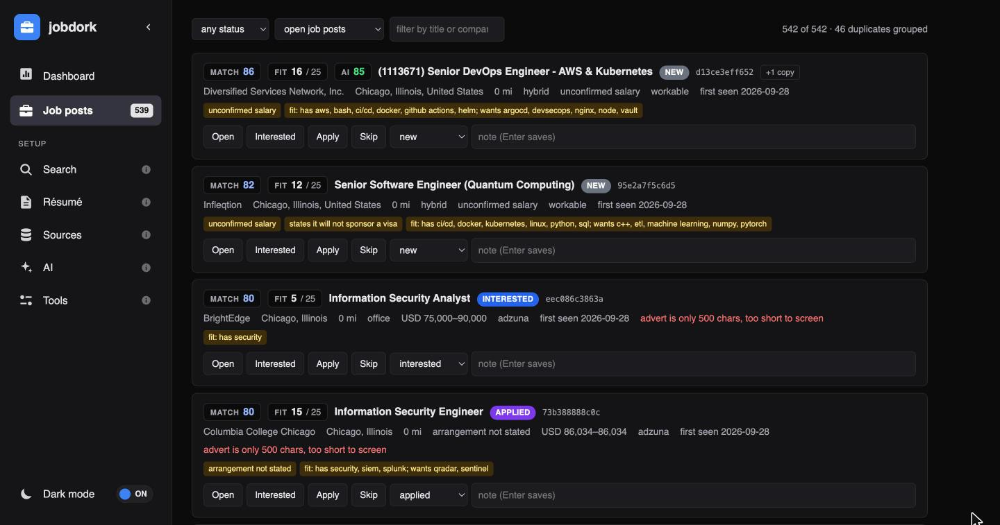
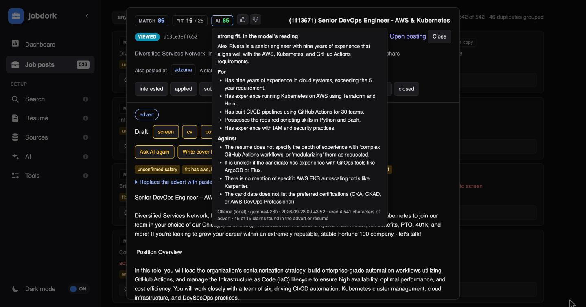
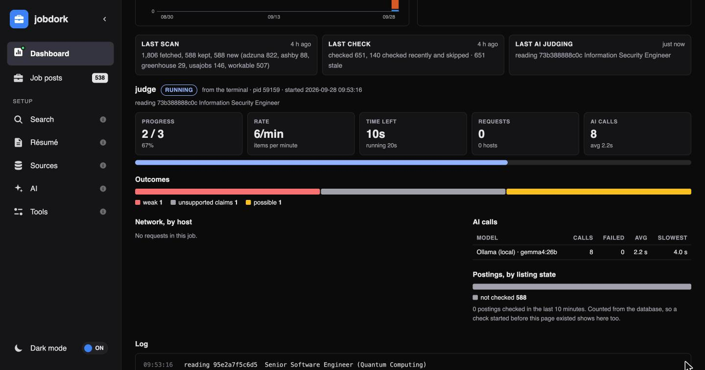

# jobDork

<!-- Health -->
[](https://github.com/jessn-dev/jobDork/actions/workflows/docker.yml)
[](https://github.com/jessn-dev/jobDork/actions/workflows/guide.yml)
[](SECURITY.md)
<!-- Ecosystem -->
[](https://github.com/jessn-dev/jobDork/releases/latest)
[](https://hub.docker.com/r/jessengolab/jobdork)
[](https://www.python.org/downloads/)
[](LICENSE)
<!-- Community -->
[](CONTRIBUTING.md)
[](https://github.com/astral-sh/ruff)
[](https://jessn-dev.github.io/jobDork/)

**New here? The [user guide](https://jessn-dev.github.io/jobDork/) shows
every page of the app, with pictures:** what Match, Fit and AI mean, every
status and button, and how to send feedback.

Find work two ways, and only hear about the roles that pass filters you wrote
down once.

**`jobdork dork`** builds Google searches you click yourself. It reaches
anything Google has indexed — including the hidden market that no applicant
tracking system exposes: role lists dropped in public Docs, recruiter posts
that go live before the listing, hiring managers to approach directly.

**`jobdork scan`** fetches structured postings straight from the ATS APIs,
screens them against your rules, and remembers what it already showed you.
Roles arrive as rows with a title, a location, an advert and sometimes a
salary — not as links.

Neither replaces the other, and the second one is why this stopped being a
query generator. A Google result is a thing you have to open to evaluate. A
row is a thing that can be filtered, scored, ranked against your resume, and
struck off when you have dealt with it.

```
$ jobdork scan
  usajobs: 156 roles, 15 requests
  adzuna: 822 roles, 25 requests
  workable: 1167 roles, 113 requests
fetched 1822, kept 660, stored 660 (660 new)
dropped: 1107x title matches nothing in titles.include; 27x 28 mi away,
outside 25 mi; 6x 147 mi away, outside 25 mi; 4x title excluded by
'support engineer'
```

That is a real run. The line worth reading is the last one: **1,107 of 1,822
roles were dropped on the title alone**, and the tool says so rather than
quietly handing you 660 and letting you assume that was everything there was.
Every drop has a reason and the reasons are counted.

Works anywhere. It ships a gazetteer of 70,026 places across 245 countries, so
a reader in Manila, Munich, Melbourne or Chicago configures their own countries
and everything else follows — including whether the radius is stated in miles
or kilometres.

Reading rather than running? [Under the hood](#under-the-hood) is the short
version and [Documentation](#documentation) lists the long one, in docs/.

---

## How is this different from a job board, or an AI job app?

**jobdork is not a job board.** Nobody posts jobs to it, it has no listings
of its own, and it has no account. It is a tool that runs on your machine and
reads the places jobs are posted, for you.

| | A job board (Indeed, LinkedIn, ZipRecruiter…) | An AI job app (matching, auto-apply) | jobdork |
|---|---|---|---|
| **Where the jobs come from** | Its own listings, and copies of other sites' | Usually a job board's feed | Employers' own hiring systems (Workday, Oracle, Greenhouse and others), employers' careers sites and keyword searches, side by side |
| **What decides what you see** | The site's ranking, which often puts paid listings first | A model's match score you cannot inspect | Rules you wrote down (titles, distance, pay, dealbreakers), with every drop counted and named; a model's opinion sits beside the score and never hides a post |
| **Copies and ghost jobs** | One job reposted under several listings; old posts left up | Inherited from the feed | Copies of one job grouped into one; posts aged from the employer's own dates; ghost listings past 90 days dropped |
| **What the AI writes** | n/a | Applications and cover letters, often sent for you | Drafts you read: a cover letter, a resume review, a tailored resume. Every claim is checked against your resume and the advert, and anything it cannot find there is flagged. It never applies for you |
| **Your resume and your searches** | On their servers, tied to an account | Uploaded to their servers | On your machine. The AI can run locally (Ollama), and with a hosted model your contact details are not sent |
| **What it costs you** | Free, paid for by your attention and data | Usually a subscription | Free and open source; a hosted model's own fees if you use one |

**What it is not good at, said plainly:** it needs setting up, it reaches
fewer employers outside North America and parts of Asia for now
([docs/REGIONS.md](docs/REGIONS.md)), it does not work around sites that
offer no public way in or refuse automated readers (Indeed, LinkedIn and
SEEK among them; `jobdork dork` builds search links for those instead), and it never applies on your
behalf. [What it cannot do](#what-it-cannot-do) has the full list.

---

## Install and run

There are four ways in, each with its own guide in
[docs/run/](docs/run/README.md):

| | For | Guide |
|---|---|---|
| **Desktop app** | macOS (Apple Silicon) and Windows: an installer, the dashboard in its own window, scheduled scans, notifications, an Update button | [docs/run/desktop.md](docs/run/desktop.md) |
| **From source** | Any system with Python 3.10+, Linux and Intel Macs included: the dashboard in your browser, or its own window | [docs/run/source.md](docs/run/source.md) |
| **In the terminal** | Every command without a dashboard: cron jobs, scripts, servers with no screen | [docs/run/cli.md](docs/run/cli.md) |
| **Docker** | The published image on your computer, or always on a NAS, opened from anywhere over Tailscale | [docs/run/docker.md](docs/run/docker.md), [docs/run/nas.md](docs/run/nas.md) |

From source, in four lines:

```bash
git clone https://github.com/jessn-dev/jobDork.git && cd jobDork
python3 -m venv .venv && .venv/bin/pip install -e '.[pdf]'
.venv/bin/python scripts/build_gazetteer.py
.venv/bin/python -m jobdork serve      # opens setup in your browser
```

Whichever you pick, the first start opens setup, one question per screen:
your resume, an AI model (or skip it), the job titles to look for (suggested
from your resume when AI is set up), where you are, pay, and what will be
searched. It ends with a first scan: a quick one, so job posts are there in
about a minute, then the rest of the employer boards in the background.
Answers are saved as you go, to `config.yaml`; stop any time and you come
back to the same step.

**There is no `config.yaml` in the repository.** It is gitignored, along with
`.env`, `data/` and `out/`, so a fresh clone has none and nothing you put in
yours ever conflicts on a pull. Your search stays yours.

## Unsigned installers

The installers on the Releases page are **not code-signed**, so macOS and
Windows warn the first time you open one;
[the desktop guide](docs/run/desktop.md#the-first-open-warning) says how to
get past it. What you can check instead:

- The installers are built from this repository's source by GitHub Actions
  ([desktop.yml](.github/workflows/desktop.yml)), from a release tag, and
  every release is approved by hand before it is published (see
  [SECURITY.md](SECURITY.md)).
- Each download carries a build attestation, so you can confirm it is the
  one this repository built
  ([how](docs/run/desktop.md#the-first-open-warning)).
- Changes reach `main` only by pull request with every check passing, and
  the owner, [@jessn-dev](https://github.com/jessn-dev), uses
  multi-factor authentication on GitHub.

**Privacy.** jobdork sends nothing to its makers. It goes on the network
only to do what you set it up to do (search job boards, use the AI provider
you choose, send feedback when you press Send) and to check, once a day, for
a newer release, which can be turned off. Every destination is listed in the
[privacy policy](PRIVACY.md).

## Where the jobs come from

**Nothing here needs a credential to start.** Workable's cross-employer search
takes a job title and answers for its whole market — no token, no account, no
list of employers to maintain. Himalayas adds remote jobs open to your
country and your hours, Kalibrr adds Philippine and Indonesian jobs, the
Bundesagentur für Arbeit (Germany's employment agency) German ones, and
Arbeitnow jobs across Europe.

Alongside them, **employer boards** read one company each, with the full
advert: Greenhouse, Ashby, Lever, Breezy, SmartRecruiters, Workday, Oracle
Recruiting Cloud, Eightfold, Taleo Business Edition, and an employer's own
careers site when it marks its postings up for search engines (SAP
SuccessFactors' career sites among them). **423 of them ship built in**, 340
of them US employers across 27 industries (hospitals,
banks, retailers, insurers, airlines, government contractors and more); a
scan reads the ones hiring in your countries, and you can narrow them to
industries or switch them off (`sources.directory`, see
[docs/SOURCES.md](docs/SOURCES.md#employer-boards-jobdork-ships-with)).

`jobdork discover` adds any other employer, by reading the board token off
their own careers page rather than guessing it from their name:

```
$ jobdork discover vectra.ai
Looking for vectra.ai...
  greenhouse         16 jobs  [verified]  .../boards/vectranetworks/jobs
                    board names itself 'Vectra'

Re-run with --add to write these into your config.
```

`vectranetworks` is why it reads rather than guesses. Tokens are not company
names — `mymoose` is Rapid7, `evergreenix` is Garrison — and a board that
answers is not proof you found the right company: on Ashby, `primer` is a
Florida micro-schools operator. Only a board found on their site **and**
returning jobs can be added; everything else is reported and refused.

Two more are registered and dormant until you add a free key: paste it in
setup's "What will be searched" step (kept in `data/source-keys.env`, readable
by you alone, never in `config.yaml`), or put it in `.env`, which wins. They
report why they skipped rather than silently not running — a source that
vanishes looks exactly like a source that found nothing:

```
$ jobdork sources
Registered but dormant — no credential:
  usajobs          free key at https://developer.usajobs.gov
  adzuna           free key at https://developer.adzuna.com/signup
```

**Adzuna** runs a separate national index per country and is the widest keyed
source: `gb us ca ie in de fr nl at be ch es it pl br mx za au nz sg`. There
is no Philippine, Indonesian,
Malaysian, Japanese or Emirati index at all, and the adapter says so by name
instead of returning nothing.

**USAJOBS** is US federal hiring, and the only source here that publishes a
salary on essentially every posting. It skips itself if the US is not in your
countries.

Getting an Adzuna key is worth one warning: the portal's own *API Access
Details* link is broken and 404s. The working page is `/admin/applications`,
which is linked from nowhere.

---

## Working outside the United States

There is no built-in region. `locations.countries` takes any ISO 3166-1
alpha-2 code the geocoder knows, and out of scope means "not in **your**
countries" — the rule is the same in every direction. A Berlin posting is
dropped for a Chicago reader and a Chicago posting is dropped for a Manila
reader, by the same line of code.

What adapts on its own:

| | |
|---|---|
| **Units** | miles for the US and UK, kilometres everywhere else. A `radius: 25` in Berlin is 25 km, not 25 miles — the difference is 2.6× the search area |
| **Adzuna** | follows `locations.countries`, so a Berlin reader gets the `de` index without knowing Adzuna calls it that |
| **USAJOBS** | skips itself outside the US |
| **Workable** | queries are spelled out, because it ignores two-letter codes *silently* — `DE` returns the whole world and looks like it worked |

Place names are the part that needed real work:

- **Accents fold both ways.** `Zurich` finds `Zürich`; `Sao Paulo` finds
  `São Paulo`.
- **English exonyms resolve.** `München` and `Munich` share almost no letters,
  so folding cannot connect them. A curated table does — along with Köln,
  Wien, Praha, Warszawa, København, Den Haag, Genève, Bombay and about thirty
  more.
- **`Makati` and `Makati City` are one place**, as are `Quezon` and
  `Quezon City`.
- **City-states work.** In Singapore the country name is also the city name.
- **`Remote - Australia` is not a city.** There is a town called Australia, in
  Cuba, with three thousand people in it.
- **`WA` depends on who is reading.** Washington to someone in Seattle,
  Western Australia to someone in Perth. Your configured countries settle it.

What a scan reaches differs by region, and is measured rather than assumed:
[docs/REGIONS.md](docs/REGIONS.md) has what reaches each region today (the US
most, then Canada and Asia), the numbers measured so far, and the plan for
Europe, the Middle East, and Australia and Oceania, which are planned and
not built yet.

---

## What a scan gives you

**It tells you what is new.** State is diffed between runs, so `list --new`
reports what appeared since last time rather than the same three hundred rows
every week.

**It tells you why something was dropped.** Every rejection is counted and
named. A filter that silently eats most of the market is worse than no filter.

**It says when a source did not really answer.** Several of these APIs return
HTTP 200 with an empty array both for a board that does not exist and for one
that is rate-limiting you. An empty answer is reported as `SUSPECT`, never as
"this company is not hiring" — those are different statements and only one of
them is honest.

**It can fetch the full advert where only a summary arrived.** `jobdork
enrich` reads schema.org `JobPosting` data off the posting page — on a test
run, six roles went from 180-character teasers to 1,462–4,479 characters, and
three of them stopped passing once the real text was screened. Adzuna is the
exception: its links answer 403 from bot protection, so its 500-character cap
is permanent and `enrich` refuses to try rather than working around a control.

**Any setting can be overridden for one run**, and each is validated exactly
as the file is:

```bash
jobdork scan --anchor "Berlin, Germany" --country DE
jobdork list --title "penetration tester" --work-mode remote --salary-floor 150000
```

`--country` carries units and the Adzuna index with it, so a German search is
in kilometres against the `de` index without your having to say so.

**It ranks against your resume, offline and free.** `.docx`, `.md`, `.txt`,
and `.pdf` with the optional `pypdf` extra. Skill overlap sorts the list and
names the gaps. No model, no tokens, no network.

### The salary rule

The one piece of behaviour worth understanding before you trust the output.

- A posting whose **stated** pay is below your floor is **hidden**.
- A posting with **no stated pay** is **shown**, marked *unconfirmed salary*.

On one 855-role run, 81 postings stated a figure. **That is 12%.** A floor that
also hid the silent ones would throw away seven jobs in eight, so only a number
the employer actually published can disqualify a role.

Day and hourly rates are annualised first, because $600 a day is $156,000 a
year and not $600. A pay period that cannot be read is treated as unknown
rather than assumed yearly — that assumption turns $50 an hour into $50 a year
and hides the job.

Salaries in a currency other than your floor's are never silently converted.
They are shown and marked *not compared*, because a wrong exchange rate drops
real jobs quietly.

Estimated salaries are discarded rather than stored. Some sources guess where
the employer published nothing; 251 of 292 Adzuna roles in one run were guesses.
A guess must never be allowed to disqualify a job.

### Remembering what you already did

A scanner that forgets shows you the same job every week.

```bash
jobdork list --new                                  # only what is new
jobdork applied <url|company|uid> -s interviewing --note "call booked"
jobdork show <uid>                                  # the full advert
jobdork rescreen --remove                           # re-apply your config
jobdork check                                       # which postings are gone
jobdork prune --older-than 30                       # preview; --yes deletes
jobdork scan --fresh                                # preview; --yes starts over
```

`check` asks each posting whether the job is still up, and closes the ones
that are gone. A copy of a job posted in several places closes only when every
copy has. `prune` clears out old or settled posts, never one you are pursuing
(applied, submitted, interviewing, offer): it previews first, backs the
database up, and a deleted post does not come back on the next scan.

`scan --fresh` (**Run fresh scan** on the Dashboard) starts over: it deletes
every job post a scan found, with its status, notes and AI verdict, and scans
again from nothing. It says how many it will delete, and how many of those you
are pursuing, before anything goes; the database is backed up first. Posts you
deleted before stay deleted, and posts added by hand are kept.

### Scans that run by themselves

**Settings → Schedule a run** (the gear at the bottom of the menu): every day,
every weekday or once a week, at a time you pick, and **Run a scan now** beside
it. It goes into your computer's own scheduler (launchd on
macOS, Task Scheduler on Windows, crontab on Linux), so it runs whether or not
jobdork is open, and a time missed while the computer slept runs when it
wakes. The scan is listed under All runs like any other, and what it printed
is in `logs/scheduled-scan.log` beside your config. Only one scan runs at a
time: one that finds another running, from the dashboard or a terminal,
steps aside. In Docker, schedule `docker exec jobdork jobdork scan --scheduled`
on the host instead ([docs/run/docker.md](docs/run/docker.md#scans-that-run-by-themselves)).

When a scan finds new job posts, your computer shows a notification with a
bell (Notification Center on macOS, a toast on Windows, `notify-send` on
Linux); so does a failed scan, and a newer jobdork. **Settings →
Notifications** turns them or their sound off. **Settings → Updates** checks
for a newer version, and in the desktop app **Update** downloads the
installer, checks it against the release's checksums, and opens it.

### Or have it mailed to you

```bash
jobdork scan --email you@example.com                # one line for a cron job
jobdork digest --email you@example.com              # mail the last scan again
jobdork digest --all --csv --email you@example.com  # everything open, CSV attached
jobdork digest --dry-run                            # print it, send nothing
```

Needs `RESEND_API_KEY` and `RESEND_FROM` in `.env` — the same two the dork
generator already uses. Free key at [resend.com](https://resend.com/api-keys).

**"New" means first seen during the most recent completed scan**, not first
seen today. Scan twice in one day and the second digest does not resend the
first one's roles.

An empty digest is not sent unless you ask for it with `--even-if-empty`. A
mail that says "nothing new" every morning trains you to ignore the one that
says something.

Statuses run `new → viewed → interested → applied → submitted → interviewing →
offer`, plus `rejected`, `withdrawn`, `skipped` and `closed`. `viewed` is set
for you when you open a post. **The four settled ones are hidden** rather than
shown again.

A status you set outranks a filter change: `rescreen --remove` deletes roles
that no longer match your config, but never one you have acted on. That status
is a decision you made and a rule change does not overrule it.

Naming a company that matches several roles **stops and lists them** rather
than guessing, because recording a status against the wrong role is worse than
not recording it.

`scan` also writes `out/index.html` — the same list as a self-contained page,
light and dark, no server and no external request.


The header line is the config that produced it, so a page you saved last week
still says what it was searching for.

### Drafting, when you want it

```bash
jobdork generate <uid> -k screen     # is this worth applying to? seconds, pennies
jobdork generate <uid> -k cv
jobdork generate <uid> -k cover_letter
```

Needs the `claude` CLI on your PATH — the desktop chat app ships no
command-line entry point. **Nothing generates unless you ask**, and screening
first is cheaper than finding a coding round after drafting a CV.

Documents land in `~/Documents/job-applications/<date>-<company>-<role>/` with a snapshot
of the advert, because postings are pulled the moment they are filled.

Every draft is checked by scripts rather than re-read by a model: any figure or
scale word not in your resume, any six-word run shared between the CV and the
cover letter, and signs of AI writing by the bundled
[humanizer](https://github.com/blader/humanizer) rules (em dashes, "not X but
Y", stock words), each named with its rule. With a model set up on the AI page,
a **hallucination check** is added: see below. Nothing is redrafted for you — a
failed gate is a thing to read before you send it. A screen is exempt from the
figure check: it is notes to yourself and it is supposed to quote the advert.

A real screen, on a role with a full advert:

> **Verdict: MAYBE — lean apply, but confirm travel and title first.**
>
> **Travel is the big one.** "Consecutive weeks spent full-time at a client
> site." Advertised as 2 days/week hybrid in Chicago, but the real shape may be
> extended on-site stints at banks. Not a normal hybrid job.
>
> **Title mismatch.** Called "DevOps Engineer," reports to Platform Engineering
> Manager, but the job described is Forward Deployed Engineer.
>
> **Pay: stated — "$140,000 - £170,000 per annum."** Currency mismatch is a
> typo (London HQ).

On a role whose advert had been truncated by an aggregator, the same command
refused rather than guessing: *"cannot screen yet. Advert is a stub."* That is
the behaviour worth having — it would rather tell you it cannot see than invent
a match.

The advert is treated as hostile input: fenced with its own markers stripped
out first, labelled as a claim rather than an instruction, and the subprocess
scoped to that one folder.

### A second reader: the AI page

A model can read what the rules cannot: the whole advert against your whole
resume. Judging, letters, reviews and tailored resumes need one; a scan does
not, and a verdict never hides a job post. List up to six readers on the AI
page (setup asks for one, with room for three): they are asked in order, and
when one cannot answer (no key, Ollama not running, rate limited) the next
one does. The same provider can be listed again with another model.

```bash
jobdork judge                 # the best job posts, read against your resume
jobdork letter <uid>          # a cover letter from your resume and the advert
jobdork review [<uid>]        # what to fix in your resume, or against one post
jobdork tailor <uid>          # your resume rewritten for one post, as a PDF
```

- **A tailored resume** follows the
  [AI-friendly template](https://resumeoptimizerpro.com/blog/ai-friendly-resume-template):
  one column, the name and one contact line, standard section names in a fixed
  order, comma-separated skills, and each job as title, then
  "Company | City, State | Month YYYY - Month YYYY", then bullets. The model
  gives the content only; jobdork lays it out and writes the PDF, so every
  provider gives the same document. The contact line is copied from your
  resume, never written by a model. An employer, school, skill or
  certification your resume does not name is left out and listed. It is saved as
  `FirstName_LastName_JobTitle_Resume.pdf`, with its Markdown beside it.
- **Projects adapt to the person.** The model judges the career stage from
  the resume and the post: a student's projects go right below Education
  (two or three), a career changer's above the jobs, a freelancer's after
  them as "Selected Client Projects", and someone with years in the field
  keeps the resume's projects inside the jobs. The heading follows the
  industry ("Technical Projects", "Portfolio Highlights", "Key Initiatives").
- **Your own projects are always shown.** Any kind of work can be described
  on the Resume page: an app, articles, a campaign, research, an event,
  volunteering, a personal project. Each has a kind, your part in it, tools,
  a link, and STAR fields (situation, task, action, result). Every one goes
  into a tailored resume, the most relevant to the job first; one the resume
  only names or links to is described in your words. For someone experienced
  they get a section after the jobs. Fit scores count their skills, and saving
  one re-scores your job posts. A common tutorial project (a to-do list, a
  weather app) is flagged as you type and in the result.
- **Education your resume does not show yet.** A degree, diploma or course
  finished since the resume was written, or one under way, is added on the
  Resume page the way a project is. Every entry goes under Education in a
  tailored resume, newest first, replacing the resume's own line for the same
  school and qualification, and fit scores count it.
- **The search applies itself.** Removing a job title or changing a rule on
  the Search page re-screens your job posts at once: ones that no longer fit,
  which you have not acted on, move to Dropped by your filters. Adding a job
  title, a country or an industry also starts a scan. While a job runs, the
  change waits for it.
- **Recruiters' posts are marked.** A post from a staffing or search firm,
  or one whose advert speaks for "our client", says "Recruiter", and Job
  posts can show only employers' or only recruiters' posts. When a post may
  be a job you already applied to the other way (the recruiter's advert names
  that employer as its client, or the title and city are the same), it says
  so, and Apply asks again: applying through a recruiter and directly can
  make you a duplicate candidate.

- **Posting dates are measured, not guessed.** A model has no clock, so the
  age of every post is worked out in code from the job board's own dates
  (see [freshness](docs/CONFIG.md#freshness)) and given to the model in its
  own block, apart from the dates in your resume. New posts rank higher,
  stale ones lower and marked, and ghost listings past 90 days are dropped.
- **Any of five providers:** Ollama running locally (free), Claude, Gemini,
  ChatGPT or Groq (open models, fast, with a free tier). **Keys are held in memory only**: typed on the AI page, never
  written to the config, the database or a log, and wiped when the server
  stops or you click Forget. The terminal reads them from the environment.
- **Judging** gives a score, a verdict and its reasons beside the rule-based
  match score. When the advert or resume is too thin, it says so and shows
  **?** rather than a guess.
- **Reading posting pages** that do not say plainly whether the job is open
  (`llm.read_pages`). Its "closed" only counts when it quotes words that are
  really on the page.
- **Every output is checked for hallucination.** Following the
  [HalluLens](https://github.com/facebookresearch/HalluLens) method, the text
  is split into single claims and each is looked up in the resume and the
  advert; a claim only counts as supported when its quote is found there by
  script. Unsupported claims are listed, struck out on a verdict and flagged
  on a letter, so "ten years of Java" where the resume says ten
  years overall does not reach an employer unread. The check costs two model
  calls per output and can be turned off (`llm.guard`).
- **A different model checks than the one that wrote it.** Choose up to six
  checkers on the AI page, tried in order like readers, so one that is down,
  out of credit or rate limited hands over to the next. With none chosen,
  another of your readers checks; the model that wrote it checks itself
  only when nothing else is ready. Checkers also score each judged job post
  themselves, and scores far apart are marked **models disagree**.
  Measured on 574 facts decided by hand, `qwen3.8:27b` checked best of
  eight local models (99% right, most real mistakes caught); a model
  checking its own work raised five false alarms for every real one.
- **Gaps are checked by script.** "The resume does not mention Django" is
  only kept if Django really is nowhere in the resume.
- **Years of experience are counted, not guessed.** jobdork reads the dated
  roles in the resume (overlaps once, study left out) and gives that figure
  to the model judging, writing a letter or tailoring the resume, and to the
  check, so no model adds up dates itself.
- **What a text says about itself is not checked.** "I am applying for…"
  in a letter, or "seeking a Software Engineer role" in a resume summary,
  is left out of the claims: no source can support it.
- **A resume review** quotes the line each point is about, and drops any
  point quoting something not in your resume. Against a post it also lists
  what the advert asks for that the resume does not show.
- **Thumbs up or down** on any AI output, counted on the Dashboard.

### Or with buttons

```bash
jobdork serve        # http://127.0.0.1:8765
```

The page opens on the **Dashboard**: runs, errored runs, AI calls, AI latency
(P50 and P95) and the hallucination rate with its coverage, for the last 7, 30
or 90 days; runs by tool and the hallucination rate by kind of output over
time, and feedback per day; and a card for the last scan,
check and AI judging that says in amber what went wrong (a source that
returned nothing, a scan that never finished, a scan over 15 days old).


**Job posts** is the list, where what you click sticks. It reads and writes the
same database the CLI does, so the two cannot disagree. Copies of one job
posted in several places show as one post.



Open one for the advert, drafts, the AI verdict and its reasons, and the
buttons to ask the AI, write a cover letter, review your resume against it,
or check it is still open:



Every run reports itself while it runs, whether it was started on the page or
in the terminal, rather than leaving you with a frozen terminal:



Settings are editable there too — titles, location, radius, countries, salary
floor, the AI provider and model. The file is written and then re-read through the normal loader, so an
edit that would not survive a scan cannot be saved.

**It prints a URL with a token in it, and that token is required.** Loopback
is not a security boundary: without one, any program running as you could read
your whole job search and change it. The token is minted per run and dies with
the process. The port is asked for rather than assumed, so it does not collide.

Local only, and deliberately hard to make otherwise: it binds to loopback and
there is no `--host`; the `Host` header is checked against the address it
actually bound to rather than against `Origin`, because under DNS rebinding
both of those are attacker-controlled and the bound address is not; a role id
must be twelve hex characters; and `GET` cannot change anything. Standard
library only — no CDN, no framework, no external request.

---

## What it cannot do

A tool that quietly fails at something looks broken rather than out of scope.

- **Employers not on a platform here, and not named by you.** Coverage is
  keyword search, the employer boards jobdork ships with (US first), and the
  companies you add. A site that refuses scripts is not worked around, and
  UKG and iCIMS have no reader yet, nor SuccessFactors without a career site
  of its own. `jobdork dork` covers
  the rest.
- **Screening an advert that arrived truncated.** Adzuna caps every advert at
  exactly 500 characters. Dealbreakers, work-mode detection and resume
  scoring all read the advert body, so on one run **517 of 653 Adzuna roles
  had no detectable arrangement, against 0 of 200 from Workable.** Adzuna is a
  discovery-and-salary source; Workable is the one you can filter on.
- **Aggregators with no public API.** Indeed retired its publisher API in
  2020, Glassdoor is partner-only, and LinkedIn's public endpoint carries no
  description and no salary. Those stay dork-only, which is the better tool
  for them anyway.
- **Salary you can filter on**, for seven postings in eight.
- **Right to work.** A posting that states its sponsorship position is
  flagged, read from the advert, and the dealbreakers "us citizen" and "no
  visa sponsorship" act on it. Most state nothing; treat an unflagged role as
  unknown rather than as available.
- **Telling a SmartRecruiters throttle from an empty board.** It answers 200
  with `totalFound: 0` for both, so a quiet board is reported as unknown
  rather than as not hiring.
- **Jobs never posted online in a system it can read.** Large employers'
  store, warehouse and care jobs are (Dollar Tree, Lowe's, Starbucks and the
  hospital systems in the built-in boards); small and local employers' trades,
  shop and care jobs mostly are not.

---

## Under the hood

The four things that were harder than they look.

**Failure usually looks like success.** Ashby and SmartRecruiters answer HTTP
200 with an empty array for a dead board and for a throttle alike, so
validation is on job count and never on the status code. USAJOBS goes further
and **ignores an unknown parameter silently, with a 200** — a search carrying
`NotARealParam` returned the same 501 results as one without it, so a
misspelled filter does not fail, it just does not filter. Greenhouse answers
403 to a GET carrying a body. Every platform's row is in
[docs/PLATFORMS.md](docs/PLATFORMS.md).

**The advert is not always the advert.** Greenhouse returns its HTML escaped —
`&lt;h2&gt;`, not `<h2>` — so a tag stripper matches nothing, returns the
entities verbatim, and every dealbreaker silently stops matching. Adzuna's
`location.display_name` is city plus *county*, "Round Rock, Williamson County",
which no gazetteer can place; the structured `location.area` is the one to
read, and parsing the wrong field left 187 of 238 roles unplaced with the
radius quietly doing nothing.

**Identity is easy to get wrong in both directions.** Greenhouse boards are
often served from the employer's own domain with the job id in the query
string, so stripping `gh_jid` as a tracking parameter collapsed 579 Stripe
jobs into one row. Meanwhile aggregators republish one vacancy under six or
seven genuinely distinct posting ids, which cannot be merged at store time
without risking the only copy — so those are collapsed on the way out instead.

**Per-host pacing, and a circuit breaker.** Concurrency governs how many
*different* boards are read at once, not how hard any one is hit: each host has
its own clock and requests interleave. A host answering three consecutive 429s
after its retries is treated as saying no rather than asking for a pause, and
is blocked for five minutes rather than retried into. A `Retry-After` over a
minute is read as a refusal for the rest of the run.

That last one is not theoretical. `jobs.workable.com` is stricter than its
per-board sibling, and a sixteen-title config at 0.7 requests a second earned
a `Retry-After` of **86,130 seconds — a full day**. The rate is now 0.4/s with
a six-page cap. Use `scan --limit` while tuning a config rather than re-running
full scans; these are other people's servers, and a job board that starts
blocking automated readers makes the market worse for everyone.

---

## Documentation

| | |
|---|---|
| [User guide](https://jessn-dev.github.io/jobDork/) | How to use the app, page by page, with pictures; source in [guide/](guide/README.md) |
| [docs/run/](docs/run/README.md) | The ways to run it, side by side, then one guide each: [desktop app](docs/run/desktop.md), [from source](docs/run/source.md), [terminal](docs/run/cli.md), [Docker](docs/run/docker.md), [NAS or home server](docs/run/nas.md) |
| [docs/CONFIG.md](docs/CONFIG.md) | Every setting, what it accepts, what happens when it is wrong |
| [docs/PLATFORMS.md](docs/PLATFORMS.md) | Each source's endpoint, quirks, rate limits and verification status |
| [docs/SOURCES.md](docs/SOURCES.md) | Where coverage comes from, board tokens, the gazetteer |
| [docs/REGIONS.md](docs/REGIONS.md) | What a scan reaches region by region, what has been measured, and the plan for the rest |
| [docs/ARCHITECTURE.md](docs/ARCHITECTURE.md) | How the pipeline fits together and why |
| [docs/DECISIONS.md](docs/DECISIONS.md) | Choices that shape jobdork, what was ruled out, and when to revisit them |
| [docs/DORK.md](docs/DORK.md) | `jobdork dork`, the Google search builder: every flag, board and example |
| [docs/HISTORY.md](docs/HISTORY.md) | How jobdork got here, from a Google search builder, and the decisions that turned around |
| [docs/CHANGELOG.md](docs/CHANGELOG.md) | What changed, and every bug found on the way |
| [SECURITY.md](SECURITY.md) | How releases are checked, signed and approved, and how to verify an image |
| [PRIVACY.md](PRIVACY.md) | What jobdork keeps, where, and every place it goes on the network |

### Start here

**Using it** — the [user guide](https://jessn-dev.github.io/jobDork/).

**Installing it** — [the ways to run it](docs/run/README.md), side by side.

**Setting it up** — [CONFIG.md](docs/CONFIG.md), then the
[minimal config](docs/CONFIG.md#minimal-working-config).

**Wondering why a role was dropped** — `jobdork list --flags`, then
[the screening rules](docs/CONFIG.md#how-a-title-is-matched) and
[the salary rule](docs/CONFIG.md#the-rule).

**Wondering why a source returned nothing** —
[Failure usually looks like success](docs/PLATFORMS.md#failure-usually-looks-like-success).

**Adding an employer's board** — [Board tokens](docs/SOURCES.md#board-tokens).

**Writing an adapter** — [Adding a source](docs/SOURCES.md#adding-a-source) and
[the adapter contract](docs/ARCHITECTURE.md#adapter-contract).

**Setting up the AI reader** — [llm](docs/CONFIG.md#llm), then
[how its output is checked](docs/ARCHITECTURE.md#the-ai-reader-and-the-guard).

### The five things worth knowing before you trust the output

**Only a positive statement by the employer can disqualify a role.** Silence
never does. A posting that states no salary, no work arrangement, or a location
nothing can parse is kept and flagged, not dropped.

**Around 12% of postings state pay.** A salary floor filters that minority and
leaves the rest visible, marked `unconfirmed salary`.

**About 60% state no work arrangement.** Those are kept whatever
`work_modes` says.

**Adzuna truncates every advert to 500 characters.** Dealbreakers, work-mode
detection and resume fit scoring all read the advert body, so Adzuna roles
cannot really be screened — it is a discovery-and-salary source. See
[the 500-character cap](docs/PLATFORMS.md#the-500-character-cap).

**An empty answer from an employer board means nothing.** Several of these APIs
return HTTP 200 with an empty array both for a board that does not exist and
for one that is throttling. Those roles are reported as `SUSPECT`, not as
"not hiring".

---

## Development

Contributions are welcome: [CONTRIBUTING.md](CONTRIBUTING.md) says how.

```bash
pip install -e '.[dev]'     # pytest and ruff
pytest                      # the whole suite
ruff check .                # lint
python tests/run_all.py     # the same tests, with nothing installed
```

`run_all.py` **discovers** every `tests/test_*.py` rather than naming them.
Naming one file means a new test file runs nowhere until somebody remembers to
add it, and the suite reports a confident pass over tests it never ran. It
catches `BaseException` rather than `Exception` for the same reason: a test
raising `SystemExit` would otherwise end the run mid-file with no failure line
and no summary.

The tests cover the rules that fail quietly — unstated salary being shown,
unresolvable locations being kept, blocker words refusing a loose title match,
day rates being annualised, `gh_jid` surviving canonicalisation, a US posting
being out of scope for a Manila reader exactly as a Berlin one is for a
Chicago reader, and a model's "supported" not counting without a quote found
in the source. None of them calls a real model or a real site.

### Building the desktop app

`python packaging/build.py` builds the installer for the machine it runs on;
what it needs and how to debug the built app are in
[docs/run/desktop.md](docs/run/desktop.md#building-the-installers-yourself).

---

## Project structure

```
.
├── run.sh                 # shell wrapper (auto-detects the venv); `./run.sh clean` clears local test data
├── config.example.yaml    # copy to config.yaml
├── Dockerfile             # the published image
├── compose.yaml           # jobdork on a NAS, as a compose project
├── jobdork/
│   ├── cli.py             # every command
│   ├── core/              # config, where the resume is kept, run telemetry, text helpers
│   ├── db/                # SQLite store, migrations, grouping copies of a job
│   ├── fetch/             # one adapter per source, robots.txt, and the paced HTTP client
│   ├── search/            # scan, screen, dealbreakers, built-in boards, freshness, enrich,
│   │                      # discover, listing check, geo, resume
│   ├── ai/                # the model, judging, the hallucination guard, AI letter and review
│   ├── writing/           # claude -p drafts and the checks every draft gets
│   ├── web/               # the dashboard server and its API; app.py, the desktop window
│   ├── output/            # the static HTML/JSON page and the email digest
│   ├── dork/              # the original Google query generator (boards.py holds its tables)
│   └── data/              # built-in employer boards, cities gazetteer, dashboard page, humanizer rules
├── packaging/             # the desktop app's build: PyInstaller spec, icon, Windows installer
├── scripts/               # build the boards list, benchmarks, gazetteer, image check
├── tests/                 # python tests/run_all.py
├── docs/
├── .github/workflows/     # tests and image (docker.yml), weekly boards re-check (boards.yml)
└── data/jobdork.db        # your database (created on first run)
```

See [docs/ARCHITECTURE.md](docs/ARCHITECTURE.md) for what each part does.

---

## Credits

jobdork builds on two other projects' work, each in its own repository:

- **[humanizer](https://github.com/blader/humanizer)** by blader (MIT), the
  rules for spotting signs of AI writing, themselves drawn from Wikipedia's
  "Signs of AI writing" guide. Its `SKILL.md` is copied into
  [`jobdork/data/humanizer/`](jobdork/data/humanizer/) with its own licence
  beside it. Drafting models are given it in full, and
  `jobdork/writing/humanize.py` checks drafts for the patterns a script can
  find. A newer `SKILL.md` copied there updates what models are told; the
  script's patterns are kept in step by hand.
- **[HalluLens](https://github.com/facebookresearch/HalluLens)** (Bang et al.,
  *HalluLens: LLM Hallucination Benchmark*,
  [arXiv:2504.17550](https://arxiv.org/abs/2504.17550)), the method the
  hallucination check follows: split an output into single claims and verify
  each against its source. Only the method is used. None of HalluLens's code,
  prompts or data is included (they are under CC BY-NC, which this licence
  could not carry); `jobdork/ai/guard.py` is jobdork's own.

Also: place names from [GeoNames](https://www.geonames.org/) (CC BY 4.0),
downloaded by `scripts/build_gazetteer.py`; icons from
[Lucide](https://lucide.dev/) (ISC), inlined in the dashboard.

## License

[GNU General Public License v3.0 or later](LICENSE) (GPL-3.0-or-later): you
may use, change and share jobdork, and anything you distribute that is built
from it must be shared under the same licence, with its source. The
humanizer rules keep their own MIT licence
([jobdork/data/humanizer/LICENSE](jobdork/data/humanizer/LICENSE)).

Privacy: [PRIVACY.md](PRIVACY.md). Installers:
[unsigned](#unsigned-installers).
