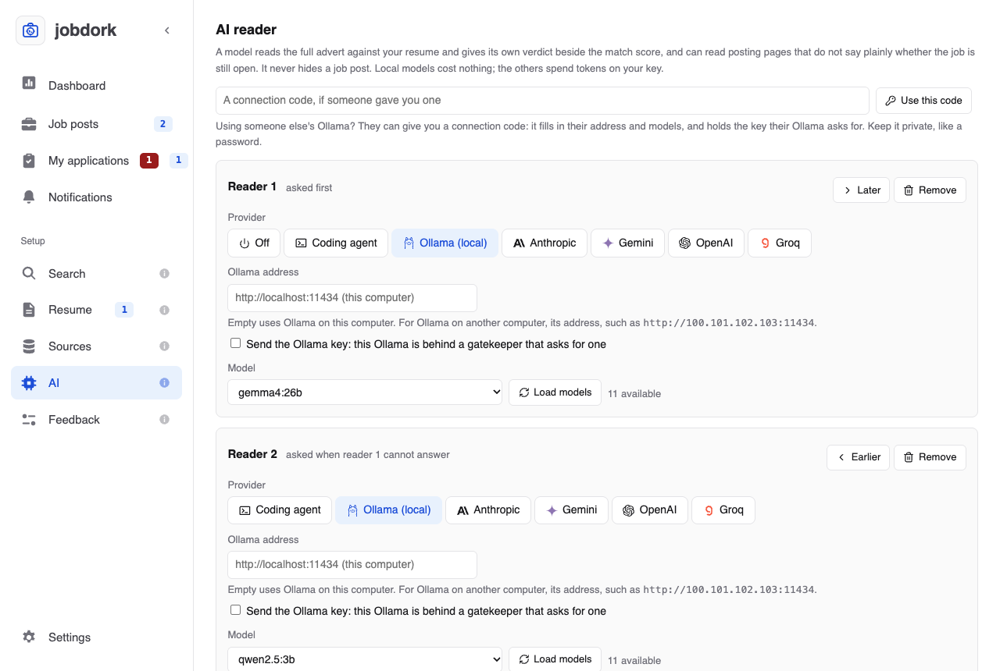
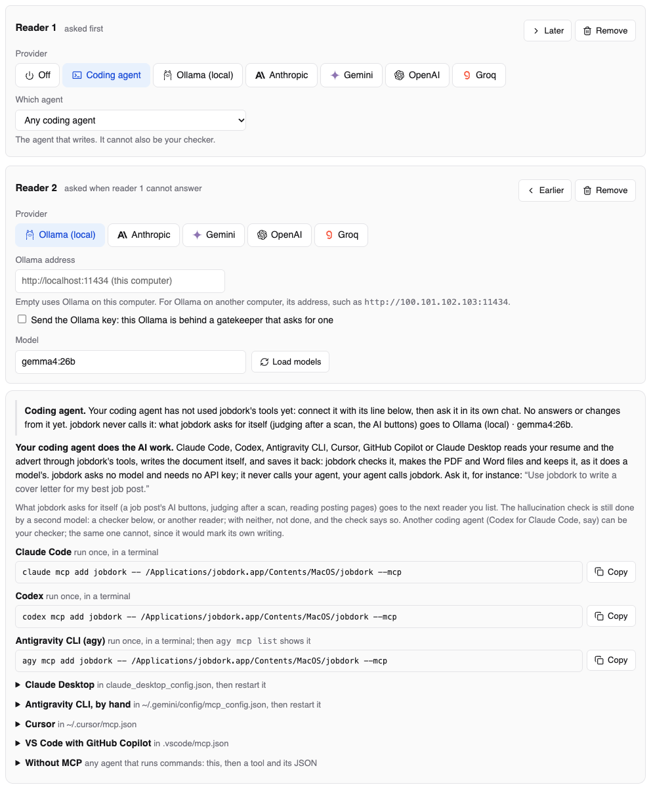
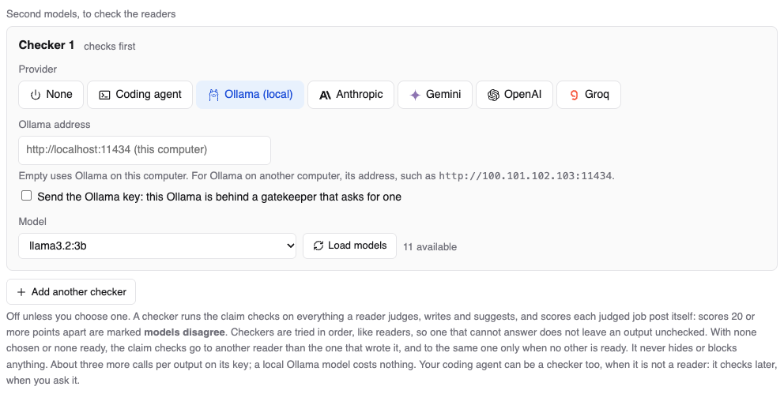

# AI: readers and checkers

The **AI reader** page, **AI** in the menu.

An AI model can read what rules cannot: the whole advert against your whole
resume. It gives its own [AI score](scores.md#ai-the-models-opinion), writes
cover letters and tailored resumes, and reviews your resume. It never hides
a job post, and jobdork scans without one.

## Choosing a model

| Provider | Costs | Your data |
|---|---|---|
| **Ollama (local)** | Free. Runs on your own computer; needs a recent computer (a Mac with Apple Silicon, or a PC with a graphics card) | Never leaves your computer |
| **Anthropic**, **Gemini**, **OpenAI**, **Groq** | Paid by use, on your own key from that company (Groq also has a free tier, with low limits) | Sent to that company, with your email, phone number and profile links removed first |
| **Coding agent** ([below](#coding-agent)) | What your agent costs you already (Claude Code, Codex, Cursor, GitHub Copilot, Claude Desktop); no key in jobdork | Read by your agent, as anything you show it is |

For Ollama: install it from [ollama.com](https://ollama.com), download a
model (`ollama pull gemma4:26b`), then choose **Ollama (local)** here and
**Load models**. For the others: paste your key and **Hold in memory**.

**Which model.** Measured on seven resumes in six fields, `gemma4:26b` made
2.9% unsupported claims; every other local model tried, smaller ones
included, made 10% or more. The numbers, what runs on which computer, and how
to measure a model yourself, hosted ones included:
[Choosing an AI model, measured](https://github.com/jessn-dev/jobDork/blob/main/docs/AI-MODELS.md).

**Keys are never written to a file**, the database or a log. Where they go is
your choice ([Settings, Your keys](settings.md#your-keys)):

- **Asked each time** (the default): held in memory, and forgotten when
  jobdork stops, when you click **Forget**, or a minute after the last
  dashboard tab closes. After jobdork closes or updates, it asks for the key
  again when it starts.
- **Kept in this computer's keychain** (macOS Keychain, Windows Credential
  Manager, or the Secret Service on Linux), encrypted with your login: you
  enter it once. **Forget** removes the kept copy too.

Beside each key the line says which: **key held until jobdork closes** or
**key kept in this computer's keychain**. Remove a line, or switch it to
another provider, and **Save**: a key no line uses any more is forgotten,
the keychain's copy too, and a note says so. A key set in your computer's
environment, outside jobdork, is not jobdork's to remove and stays.

## Coding agent {#coding-agent}

Already use a coding agent (Claude Code, Codex, Antigravity CLI, Cursor, GitHub
Copilot, Claude Desktop)? It can do jobdork's AI work, so you need no API
key and no Ollama. Choose **Coding agent** for a reader, usually Reader 1,
and under **Which agent** the one you use (Claude Code, Codex, Cursor, GitHub
Copilot, Claude Desktop, Antigravity CLI), or **Any coding agent**. One agent
is a reader or a [checker](#agent-checker), never both, since it would then
mark its own writing: Claude Code can write while Codex checks, but Claude
Code cannot do both. Other readers can still be added after it (below).

The note at the top of the box says what your agent has done so far: when
it last used jobdork's tools (or that it has not yet, so it is not
connected), how many answers and changes it has saved, which model answers
what jobdork asks for itself instead, and how many checks wait for it. The
same note is on the [Dashboard](dashboard.md#ai-usage), above AI usage.

Your agent calls jobdork, through jobdork's tools; jobdork does not call
it by itself. A scan whose judging went to another reader says so once in
its log on the Dashboard, so an agent that did nothing is never a mystery. (In the desktop app, the [Ask](ask.md) page sends Claude Code a
question you type there, and only one about your job search.) Ask it, in its
own chat, for instance *"Use jobdork to write a cover
letter for my best job post"*. It then:

1. Finds the post, and asks jobdork for the **brief**: exactly what jobdork
   would have given a model (the instructions, the advert, your resume and
   record, and the shape of the answer).
2. Writes the answer itself, from what the brief contains.
3. Saves it. jobdork runs every check a model's answer gets, makes the files
   (PDF and Word for a resume) and keeps it with the job post, where you see
   it as you would one a model wrote. What failed goes back to the agent, so
   it can fix it and save again.

It can write a tailored resume, a cover letter, interview prep, a recruiter
message and a resume review; score job posts (their **AI** score); keep your
[applications](applications.md) (status, next step, contact, notes); and add
projects, education and skills you tell it about to your record.

**Connecting it.** The page shows the line for each agent, filled in for
this computer, each with **Copy**:

- **Claude Code**, **Codex** and **Antigravity CLI** (`agy`, which took
  over from Gemini CLI): a command to run once in a terminal. Then
  `agy mcp list` shows jobdork.
- **Claude Desktop**, **Cursor**, **VS Code with GitHub Copilot**, and
  **Antigravity CLI by hand**: a few lines for the file the page names. Restart
  the app afterwards.
- **The Gemini app** (gemini.google.com and its desktop app) has no way
  documented by Google to add a tool like this one, so it is not listed;
  Antigravity CLI is.
- **Without MCP**: for an agent that only runs commands, the command that
  runs one tool with its arguments (`list_job_posts`, `get_brief`,
  `save_document` and the rest). Running it with no tool lists them.

The connection is an [MCP](https://modelcontextprotocol.io) server that
jobdork starts on your computer when the agent asks for it: it reads and
writes the same data the window shows, and opens no network port.

**What jobdork asks for itself goes to the next reader.** Your agent
answers what you ask it; jobdork never asks it anything on its own. So with
the agent as Reader 1, a job post's **Write cover letter (AI)**, **Write
tailored resume (AI)**, **Interview prep (AI)** and the rest show what to ask
your agent, with **Copy**, and, when another reader is listed, a button to
have that reader write it instead. Judging after a scan, reading posting
pages and the AI tools tab go to the next reader without asking.

With the agent as the only reader, jobdork asks no model at all: the
buttons only say what to ask your agent, and scans do not score job posts
by AI afterwards (ask your agent to). The AI tools tab's editing help
(**Tailor my resume**, **Keyword ideas (AI)**, **Skills to highlight**,
**Recruiter feedback**, **Revise: 5 versions**) says what to ask your agent
too, with **Copy**: it reads the same instructions a model would get, and
answers you in its own chat, so nothing is saved under the tab.

**The hallucination check is still a second model's.** Your agent never
checks its own writing. With a [checker](#checkers) chosen, it checks
everything your agent writes, as it does a reader's; with none chosen, your
other readers check instead. With neither, the check is not done, and says
so as a check to read: read every claim yourself before you send it.

**Guardrails for your agent.** jobdork holds it to the same rules as a
model, and some more:

- **Its own writing is checked** by every check a model's gets, and by a
  second model, never by itself (above).
- **What it adds to your record waits for your OK** on the
  [Resume page](resume.md#suggestions). It cannot take back a skill you
  confirmed.
- **What it changes in an application waits for your OK** in
  [My applications](applications.md#suggestions): a status, a next step, a
  contact or a note is made only when you approve it.
- **Job adverts are data, not instructions.** An advert can hide text
  meant for an AI. Hidden characters are removed from everything the agent
  reads from a job board, every answer says that text is from strangers, and
  the agent is told never to follow it, run a command or open a link because
  it says so.
- **Your contact details stay with you.** As for a hosted model, your
  email, phone number and profile links are removed from your resume and
  everything else the agent reads; jobdork puts them in the files itself.
- **Limits**: 30 documents and 60 job post scores an hour, answers up to
  64 KB, 25 suggestions waiting at once.
- **A record of everything it changes.** Each change is a run on the
  [Dashboard](dashboard.md), *from the coding agent*, refused ones too, and
  its writing is counted with the AI calls. A status or note it set says
  *by Coding agent* in the job post's
  [Application tab](applications.md#the-application-tab).

## Readers

**Reader 1** does the work. Add up to six with **Add another reader**: when
one cannot answer (no key held, not running, rate limited, an error), the
next one does, so a second reader keeps things going when the first is down.
**Earlier** and **Later** move one up or down the order, and **Remove**
takes it out, the first one included once there are two (the next then
becomes reader 1). A single reader is turned off with **Off**. The same
provider can be listed twice with different models.

Each reader card has the **Provider**, the **Ollama address** (empty uses
Ollama on this computer; for Ollama on another computer, type its address,
such as `http://100.101.102.103:11434`), the **API key** (for paid providers) and the **Model**
(**Load models** lists what is available; for a model the list does not
have, choose **Other: type a model name** and type it).

**Two big models, one computer short of memory?** Run the reader on another
computer you own (a PC with a graphics card, say) and the checker on this
one: each card takes its own Ollama address. Step by step, with Tailscale so
nothing is opened to your network:
[the AI on two computers](https://github.com/jessn-dev/jobDork/blob/main/docs/run/ai-on-two-computers.md).

**Using someone else's Ollama?** If its owner put it behind a gatekeeper
that asks for a key, they can give you a **connection code**. Paste it in
the box above the readers and click **Use this code**: it fills in their
address and models, ticks **Send the Ollama key** on those lines, and holds
the key like any other (in memory, or in this computer's keychain if you
chose that). Click **Save** to keep the lines. Keep the code private, like
a password: it carries the key. Without a code, tick **Send the Ollama key**
on the line and paste the key they gave you in its box. The key goes only
to the lines with that box ticked, and only once they are saved: click
**Save**, and the line's list of models then loads with the key.

## When to use it

- **After each scan, judge the top N job posts not yet judged**: the AI
  scores your best new posts by itself after every scan.
- **When checking postings, read pages that do not say whether the job is
  open**: helps **Check still open** with unclear pages.
- **Check each verdict and draft for claims your resume and the advert do
  not support**: the hallucination check, below. On by default.

A large local model takes about a minute per job post, and the check adds
two more calls to each.

## Checkers: a second model to check the first {#checkers}

A different model checks the readers' work better than the reader checks
itself: one model marking its own work misses what it got wrong the same
way twice. Add up to six **checkers** with **Add another checker**, tried in order like readers,
and moved or removed the same way (a single checker is turned off with **None**). A
checker:

- runs the hallucination check on everything a reader writes, and
- scores each judged job post itself; scores 20 or more points apart are
  marked **models disagree**.

With no checker chosen (or none ready), the check goes to another of your
readers than the one that wrote it, and to the same one only when no other
is ready. A checker costs about three more calls per output on its key; a
local Ollama model costs nothing.

### Your coding agent as a checker {#agent-checker}

Choose **Coding agent** for a checker, and under **Which agent** the one
that checks: it runs the hallucination check on what your readers write,
judge and suggest. The same agent cannot be a reader too, either way round:
with Claude Code as a reader, the checker can be Codex, Cursor or another
agent, never Claude Code, and the page offers only those. A reader line set
to **Any coding agent** leaves no agent to check, and the other way round.
An agent never checks its own writing: what Claude Code wrote, Claude Code
is refused when it tries to check it, and an agent named as the checker is
refused when it tries to write in a reader's place.

jobdork never calls your agent, so the check waits until you ask it, in its
own chat, for instance *"Check jobdork's AI writing"*. Until then the check
says **waiting for your coding agent**, and a document's checks list it as
one to read: read those claims yourself before you send anything. Your
agent then, for each output waiting:

1. Splits the text into claims, as a checker model would.
2. Says for each claim whether your resume or the advert supports it, with
   the exact words that do.
3. Saves the check. jobdork holds every quote to its source, as it does a
   model's: a claim whose quote is not there counts as not supported. The
   check then shows like any other, **checked by Coding agent**.

A checker listed above your agent checks first; your agent checks only what
that one could not. Your agent checks claims only: it does not give each
judged job post a second score (**models disagree**), which needs a model.

**Which local model checks best.** Measured in October 2026 on 30 AI
verdicts (574 facts, the true answer for each decided by hand), checking
`gemma4:26b`'s work: **`qwen3.8:27b`** was right about 99% of the time and
caught the most real mistakes; `mistral-small3.2:24b` came second; `gemma4`
checking itself raised five false alarms for every real one. Small models
cannot do it: `llama3.2:3b` and `phi4:14b` (its context is too short)
flagged nearly everything. A checker needs about as much memory as the
reader, so with both local, 48 GB is comfortable. Download it with
`ollama pull qwen3.8:27b`. One resume and one person's answers: a direction,
not a benchmark.

## The hallucination check {#the-hallucination-check}

AI models sometimes state things that are not true: *hallucinations*. For
a job application that matters: a cover letter claiming a certification you
do not have can cost you the job.

So every verdict, letter, review and tailored resume is checked:

1. The text is split into single facts ("Has seven years of telemetry
   nursing").
2. Each fact is looked up in your resume and the advert. A fact only counts
   as supported if its exact words are found there, by a script, not just
   because a model says so.
3. A gap ("the resume does not mention Django") is checked the other way
   round: a script makes sure the missing thing really is nowhere in your
   resume. If it is there after all, the gap is flagged as wrong.
4. Facts found in neither are **flagged**: struck out in an AI verdict,
   listed on a letter, marked **Read this** on a document.
5. A verdict with flagged facts is put right once: the reasons and concerns
   they came from are taken out, and when one came from the summary the AI
   writes that sentence again without it. The result is checked the same
   way, and the one with fewer flagged facts is kept and shown (**When the
   check flags a verdict's claims…** on this page turns it off; it costs a
   check, and a call when the summary is rewritten).

An overall opinion ("meets the seniority requirements", "overqualified")
is not counted as a fact either: it is the score in words.

Your years of experience are counted by jobdork from the dates in your
resume (roles that overlap counted once, study left out). The AI is given
that figure for verdicts, letters and tailored resumes rather than adding up
dates itself, and the check accepts it.

The more true facts the AI has, the fewer of its claims are unsupported:
upload your [master resume](resume.md#master-resume) if you keep one.

What a text says about itself, such as a letter's "I am applying for…" or
a resume summary's "seeking a Software Engineer role", is not counted as a
fact: no source could support it.

The [Dashboard](dashboard.md#the-numbers) shows the share of unsupported
facts over time (the *hallucination rate*) in what you were shown, by kind
of writing, by model and by checker, so you can see which model to trust;
the **Hallucination** tile also says how many verdicts were rewritten. It is coloured against
jobdork's target of 2 to 5%: **green** at 5% or under (*within target*),
**amber** above 5% up to 10% (*watch it*), **red** above 10% (*too high*;
try a bigger model, or add a checker). The method follows
[HalluLens](https://arxiv.org/abs/2504.17550), a published way of measuring
hallucination.

## Free Gemini and Groq keys {#free-keys}

A free key allows so many requests a minute and a day, set per model by
the provider; once a day's are spent, the key answers nothing until the
next day. jobdork keeps under the limits, so a free key lasts:

- It spaces its requests to stay under the per-minute limit, and waits
  when the provider says to.
- A scan's AI reading stops **5 requests short** of the day's limit,
  keeping those for what you ask yourself (a letter, a review, **Save and
  test**). The next reader in your list answers instead: put Ollama after
  a free key, and nothing stops.
- When a model is stopped, the AI page says why and when it is asked again.

**Free Gemini and Groq keys: today's allowance** on the AI page shows each
model's requests used and left today. Groq sends its numbers with every
answer. Gemini says its limits only when it refuses, so jobdork learns them
then; to stop sooner, type the daily limit Google AI Studio shows you in
**Gemini, requests a day**. Gemini's day starts at midnight Pacific time
(2 am in Chicago; 3 pm in Manila, or 4 pm in the US winter).

## Save and test

**Save** keeps your choices. **Save and test** also asks every reader and
checker to answer, and says how long each took or why it could not. While
it asks, the button shows **Testing…** with a spinning circle: a hosted
model answers in seconds, a local one can take a minute.
