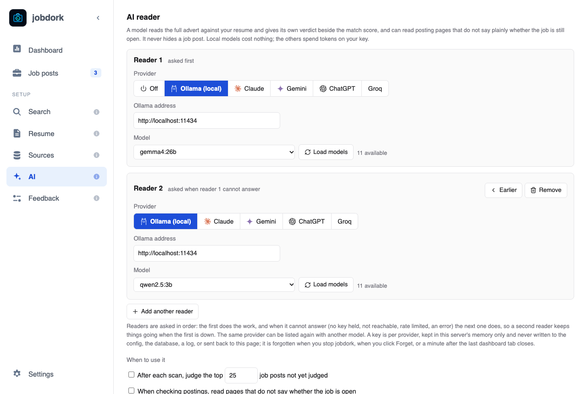
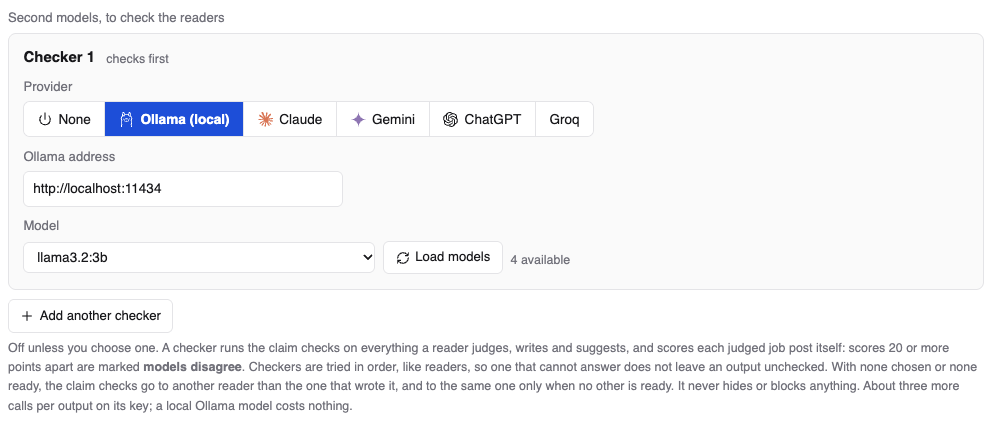

# AI: readers and checkers

The **AI reader** page, **AI** in the menu.

An AI model can read what rules cannot: the whole advert against your whole
resume. It gives its own [AI score](scores.md#ai-the-models-opinion), writes
cover letters and tailored resumes, and reviews your resume. It never hides
a job post, and jobdork scans without one.

## Choosing a model

| Provider | Costs | Your data |
|---|---|---|
| **Ollama (local)** | Free. Runs on your own computer; needs a recent computer (a Mac with Apple Silicon, or a PC with a graphics card) | Never leaves your computer |
| **Claude**, **Gemini**, **ChatGPT**, **Groq** | Paid by use, on your own key from that company (Groq also has a free tier, with low limits) | Sent to that company, with your email, phone number and profile links removed first |

For Ollama: install it from [ollama.com](https://ollama.com), download a
model (`ollama pull gemma4:26b`), then choose **Ollama (local)** here and
**Load models**. For the others: paste your key and **Hold in memory**.

**Which model.** Measured on seven resumes in six fields, `gemma4:26b` made
2.9% unsupported claims; every other local model tried, smaller ones
included, made 10% or more. The numbers, what runs on which computer, and how
to measure a model yourself, hosted ones included:
[Choosing an AI model, measured](https://github.com/jessn-dev/jobDork/blob/main/docs/AI-MODELS.md).

**Keys are never written to a file**, the database or a log. Where they go is
your choice ([Settings, Your keys](settings.md#your-keys)):

- **Asked each time** (the default): held in memory, and forgotten when
  jobdork stops, when you click **Forget**, or a minute after the last
  dashboard tab closes. After jobdork closes or updates, it asks for the key
  again when it starts.
- **Kept in this computer's keychain** (macOS Keychain, Windows Credential
  Manager, or the Secret Service on Linux), encrypted with your login: you
  enter it once. **Forget** removes the kept copy too.

## Readers

**Reader 1** does the work. Add up to six with **Add another reader**: when
one cannot answer (no key held, not running, rate limited, an error), the
next one does, so a second reader keeps things going when the first is down.
**Earlier** moves one up the order; **Remove** takes it out. The same
provider can be listed twice with different models.

Each reader card has the **Provider**, the **Ollama address** (for Ollama on
another computer), the **API key** (for paid providers) and the **Model**
(**Load models** lists what is available; for a model the list does not
have, choose **Other: type a model name** and type it).

**Two big models, one computer short of memory?** Run the reader on another
computer you own (a PC with a graphics card, say) and the checker on this
one: each card takes its own Ollama address. Step by step, with Tailscale so
nothing is opened to your network:
[the AI on two computers](https://github.com/jessn-dev/jobDork/blob/main/docs/run/ai-on-two-computers.md).

## When to use it

- **After each scan, judge the top N job posts not yet judged**: the AI
  scores your best new posts by itself after every scan.
- **When checking postings, read pages that do not say whether the job is
  open**: helps **Check still open** with unclear pages.
- **Check each verdict and draft for claims your resume and the advert do
  not support**: the hallucination check, below. On by default.

A large local model takes about a minute per job post, and the check adds
two more calls to each.

## Checkers: a second model to check the first {#checkers}

A different model checks the readers' work better than the reader checks
itself: one model marking its own work misses what it got wrong the same
way twice. Add up to six **checkers** with **Add another checker**, tried in order like readers. A
checker:

- runs the hallucination check on everything a reader writes, and
- scores each judged job post itself; scores 20 or more points apart are
  marked **models disagree**.

With no checker chosen (or none ready), the check goes to another of your
readers than the one that wrote it, and to the same one only when no other
is ready. A checker costs about three more calls per output on its key; a
local Ollama model costs nothing.

**Which local model checks best.** Measured in October 2026 on 30 AI
verdicts (574 facts, the true answer for each decided by hand), checking
`gemma4:26b`'s work: **`qwen3.8:27b`** was right about 99% of the time and
caught the most real mistakes; `mistral-small3.2:24b` came second; `gemma4`
checking itself raised five false alarms for every real one. Small models
cannot do it: `llama3.2:3b` and `phi4:14b` (its context is too short)
flagged nearly everything. A checker needs about as much memory as the
reader, so with both local, 48 GB is comfortable. Download it with
`ollama pull qwen3.8:27b`. One resume and one person's answers: a direction,
not a benchmark.

## The hallucination check {#the-hallucination-check}

AI models sometimes state things that are not true: *hallucinations*. For
a job application that matters: a cover letter claiming a certification you
do not have can cost you the job.

So every verdict, letter, review and tailored resume is checked:

1. The text is split into single facts ("Has seven years of telemetry
   nursing").
2. Each fact is looked up in your resume and the advert. A fact only counts
   as supported if its exact words are found there, by a script, not just
   because a model says so.
3. A gap ("the resume does not mention Django") is checked the other way
   round: a script makes sure the missing thing really is nowhere in your
   resume. If it is there after all, the gap is flagged as wrong.
4. Facts found in neither are **flagged**: struck out in an AI verdict,
   listed on a letter, marked **READ** on a document.

Your years of experience are counted by jobdork from the dates in your
resume (roles that overlap counted once, study left out). The AI is given
that figure for verdicts, letters and tailored resumes rather than adding up
dates itself, and the check accepts it.

What a text says about itself, such as a letter's "I am applying for…" or
a resume summary's "seeking a Software Engineer role", is not counted as a
fact: no source could support it.

The [Dashboard](dashboard.md#the-numbers) shows the share of unsupported
facts over time (the *hallucination rate*), by kind of writing and by
model, so you can see which model to trust. It is coloured against
jobdork's target of 2 to 5%: **green** at 5% or under (*within target*),
**amber** above 5% up to 10% (*watch it*), **red** above 10% (*too high*;
try a bigger model, or add a checker). The method follows
[HalluLens](https://arxiv.org/abs/2504.17550), a published way of measuring
hallucination.

## Save and test

**Save** keeps your choices. **Save and test** also asks every reader and
checker to answer, and says how long each took or why it could not. While
it asks, the button shows **Testing…** with a spinning circle: a hosted
model answers in seconds, a local one can take a minute.
