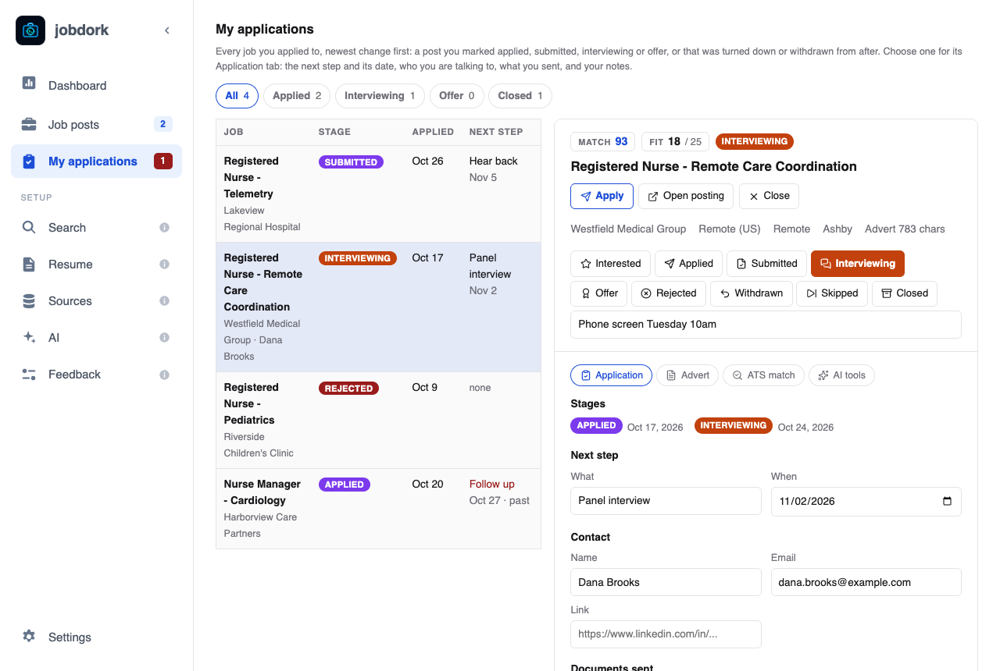
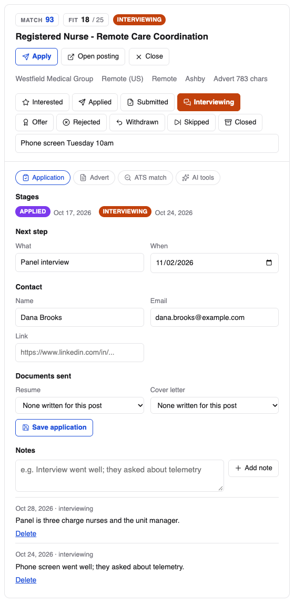

# My applications

**My applications**, in the menu under Job posts, lists every job you
applied to, newest change first: a post you marked *applied*, *submitted*,
*interviewing* or *offer*, or one that was *rejected* or *withdrawn* after
that. A post you only looked at, or skipped, is not an application and stays
on [Job posts](job-posts.md).

## The list

The chips at the top narrow it to one stage, with how many are at each:
**All**, **Applied** (*applied* and *submitted*), **Interviewing**,
**Offer** and **Closed** (*rejected*, *withdrawn*, and a job that closed or
that you skipped after applying).

Each row is a job: its title and employer (and who you are talking to, once
saved), its [status](statuses.md#statuses), the day you applied, and the
next step with its date. A next step past its date is red, with *past*.

Click a row to see it. On a wide window it opens beside the list, as on Job
posts; on a narrower one, in the [job post window](job-window.md). Either
way it opens on its **Application** tab.

## The Application tab

A job post you applied to has an **Application** tab, first among its tabs,
wherever it is opened:

- **Stages**: each status the job was given, with the day. jobdork dates
  every status change from now on; a post you applied to before this
  version starts from its status then, dated when you set it.
- **Next step**: what happens next and when, for instance *Phone screen*
  on Tuesday, or *Follow up* in a week.
- **Contact**: the recruiter or hiring manager, with an email address or
  a link (a LinkedIn profile, say).
- **Documents sent**: which of this post's tailored resumes and cover
  letters you sent. Only documents written for this post are offered; write
  them from its **AI tools** tab.

**Save application** keeps all three. Everything stays on this computer.

**Notes**: write one and press **Add note**. Each is dated and filed under
the job's status at the time, newest first, so the log reads as the
application went. **Delete** removes one; it asks first (**Delete note?**).

A status, a next step, a contact and notes belong to the job, not the link:
when one job is posted in several places, every copy shares them.

## Follow-ups past their date

When a next step's date has passed on an application still going, the menu
shows how many beside **My applications**, in red, and the
[Dashboard](dashboard.md) says which, with **Open My applications**. Set a
new date, or a new status, and it goes.
