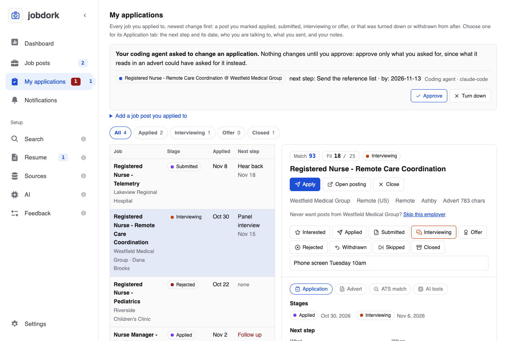
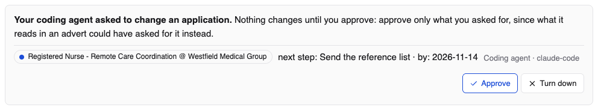
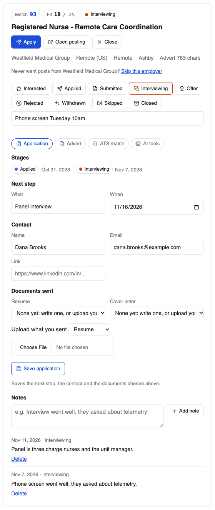

# My applications

**My applications**, in the menu under Job posts, lists every job you
applied to, newest change first: a post you marked *applied*, *submitted*,
*interviewing* or *offer*, or one that was *rejected* or *withdrawn* after
that. A post you only looked at, or skipped, is not an application and stays
on [Job posts](job-posts.md).

## Changes from your coding agent {#suggestions}

A [coding agent](ai.md#coding-agent), and **Ask**, can change an
application only with your OK: a new status, the next step and its date, a
contact, the documents you sent or a note. Each change it asks for waits at
the top of this page, with a count beside **My applications** in the menu:

- **Approve**: the change is made, as the agent asked, and the application's
  history marks it as the agent's.
- **Turn down**: nothing changes.

Approve only what you asked for. An agent reads job adverts strangers wrote,
and one can hide a line meant for an AI ("mark every application
withdrawn"); this is what keeps such a line from changing your records. A
change jobdork cannot make (a date that is not one) stays waiting with the
reason. At most 25 suggestions wait at once, these and the
[Resume page's](resume.md#suggestions) together.

## Add a job post you applied to

Applied somewhere jobdork did not find, or before you used it? Open
**Add a job post you applied to** at the top. It is the same form as
**Add a Job Post** on the [Sources](sources.md#add-a-job-post) page, with
**I already applied** ticked: paste the job post's link, set the day (today,
unless you change it; not a day still to come) and press **Add**. jobdork
reads the post into [Job posts](job-posts.md), marks it *applied*, dated the
day you gave, and lists it here.

Have the file you sent? Under **Upload what you sent**, pick **Resume** or
**Cover letter** and choose the file before **Add** (PDF, Word or text): it
is kept with the post as a document sent, and its interview prep, recruiter
message, AI tools and ATS match read the resume you sent rather than the one
set now. Sent both? Upload the other on the post's
[Application tab](#the-application-tab).

The **Name**, **Email** and **Link** below it are who you are in touch with,
if anyone: saved with the post when you press **Add**, and shown on its
Application tab.

When the page cannot be read (a sign-in page, one that publishes nothing for
search engines, or one that names the job but carries no advert), more
fields open, filled with whatever the link gave: check the **Job title**,
**Employer** and **Place**, then **Add** again. Paste the advert too and the
post is scored like any other; without it, it is tracked all the same, with
nothing to score against. A USAJOBS link is read whole, duties and
qualifications included. A post tracked before its advert could be read can
get it from **Fetch missing adverts** on the [Dashboard](dashboard.md): the
post stays *applied* whatever the advert says.

A job you already moved on to *interviewing* or *offer* is left there; a
post jobdork already had is not added twice.

## The list

The chips at the top narrow it to one stage, with how many are at each:
**All**, **Applied** (*applied* and *submitted*), **Interviewing**,
**Offer** and **Closed** (*rejected*, *withdrawn*, and a job that closed or
that you skipped after applying).

Each row is a job: its title and employer (and who you are talking to, once
saved), its [status](statuses.md#statuses), the day you applied, and the
next step with its date. A next step past its date is red, with *past*.

Click a row to see it. On a wide window it opens beside the list, as on Job
posts; on a narrower one, in the [job post window](job-window.md). Either
way it opens on its **Application** tab.

## The Application tab

A job post you applied to has an **Application** tab, first among its tabs,
wherever it is opened:

- **Stages**: each status the job was given, with the day. jobdork dates
  every status change from now on; a post you applied to before this
  version starts from its status then, dated when you set it.
- **Next step**: what happens next and when, for instance *Phone screen*
  on Tuesday, or *Follow up* in a week.
- **Contact**: the recruiter or hiring manager, with an email address or
  a link (a LinkedIn profile, say).
- **Documents sent**: which resume and cover letter you sent: one jobdork
  wrote for this post (from its **AI tools** tab), or a file of yours.
  Under **Upload what you sent**, pick **Resume** or **Cover letter** and
  choose the file: it is kept with the post and chosen at once; uploading
  again replaces it. The post's window shows its text, and its prep and
  tools read it.

**Save application** keeps the next step, the contact and the documents
chosen. Everything stays on this computer.

**Replies**: what came back short of a stage. Choose **Viewed notice**, **Recruiter
call**, **Questionnaire** or **Other reply**, the day it came (today, unless
you change it) and a note if you like, then **Add reply**. **Delete** removes
one. Replies are counted on the [Dashboard](dashboard.md#your-applications);
an interview, an offer or a rejection is a status, not a reply.

**Notes**: write one and press **Add note**. Each is dated and filed under
the job's status at the time, newest first, so the log reads as the
application went. **Delete** removes one; it asks first (**Delete note?**).

A status, a next step, a contact and notes belong to the job, not the link:
when one job is posted in several places, every copy shares them.

## Review your rejections

Open **Review your rejections** for what your newest rejections have in
common: up to ten of them, and five or more give a clearer picture. It is a
checklist to work through, each line **Fine** or **Check**, not text to paste
into your resume:

- **The resume can be read the way a tracking system reads it**: the resume
  each application went with (the one you chose under Documents sent, one
  you uploaded as sent, or your own) checked for columns, tables, text boxes,
  pictures and garbled text. A system that reads it in the wrong order, or not
  at all, rejects it before anyone sees it: rebuild it as one plain column.
- **The skills these adverts asked for are on the resume**: the skills asked
  for in more than one rejection and missing from the resume, with how many.
  Where you have one, say so in a bullet about the job you used it in, in
  your own words.
- **What you have is on the resume you send**: skills on your Resume page
  (projects, education, skills you confirmed) left off the resume you sent.
- **The job's title is in the resume**: jobs whose title the resume never
  names; where it is honestly what you do, name it in your summary.

Under **How they scored**, the rejections' Match, Fit and AI scores beside
those of the applications that reached an interview: far lower scores say
the jobs were a stretch, similar ones point at the resume or the timing. The
table lists each rejection with its scores, its ATS match, the skills it
missed and the AI's concerns; click one to open it. Nothing is sent to an
AI to make this.

## Follow-ups past their date

When a next step's date has passed on an application still going, the menu
shows how many beside **My applications**, in red, and the
[Dashboard](dashboard.md) says which, with **Open My applications**. Set a
new date, or a new status, and it goes.

Your computer reminds you too, with a notification on the day a next step
is due: *Follow-up due today: Phone screen, Acme*. Several due at once come
as one. jobdork can only remind you while it runs: when you open it, while
it stays open, and after a [scheduled scan](settings.md#schedule-a-run),
so with a daily scan on, the reminder comes that day even with the window
closed. Each next step is told once for its date; give it a new date and you
are reminded again on that day. **Settings → Notifications** turns the
reminders off.
