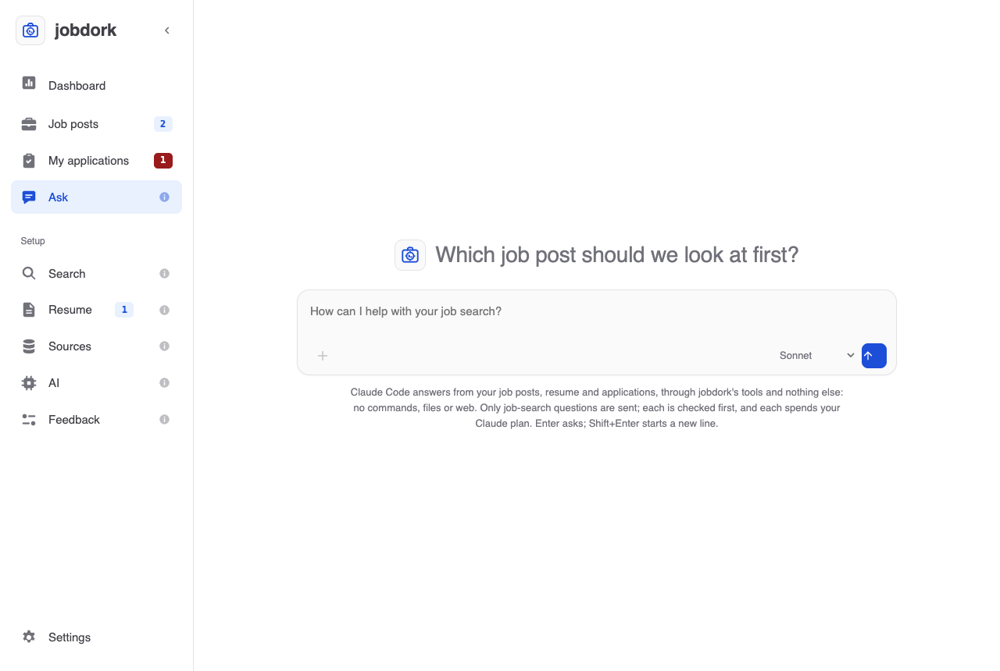
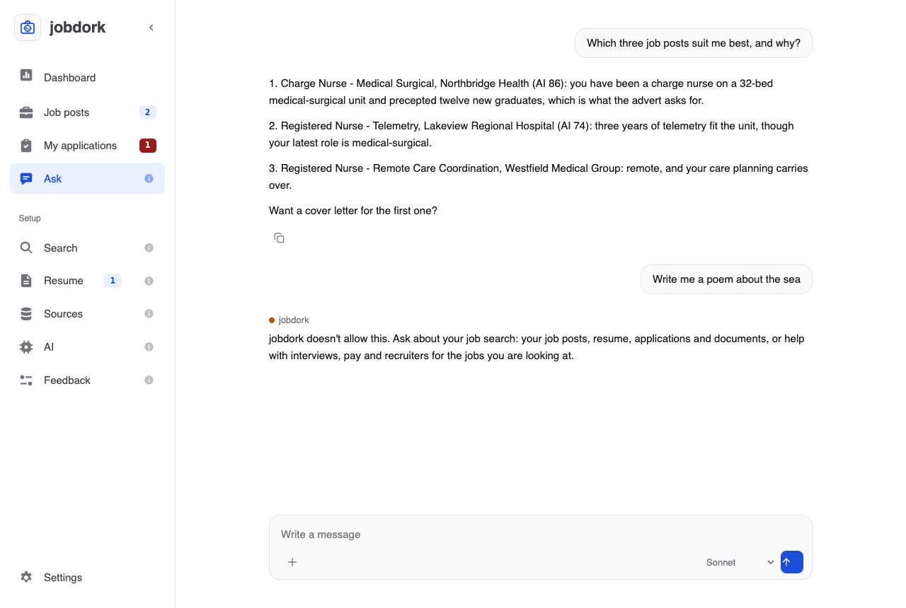

# Ask Claude Code

In the desktop app, the **Ask** page lets you ask
[Claude Code](https://claude.com/claude-code) about your job search, in
your own words, without leaving jobdork. It answers from your job posts,
your resume and your applications, through jobdork's tools, and can save a
document to a job post or suggest an addition to your resume for your OK.

## Asking

Before the first question, the page shows the jobdork mark and a line
picked at random for each conversation, such as *Which job post should we
look at first?*, over the box. Type a question in the box and press **Enter** (or the arrow button);
**Shift+Enter** starts a new line. For instance:

- *Which three job posts suit me best, and why?*
- *Write a cover letter for the Northbridge Health job post.*
- *What should I add to my resume for the telemetry jobs?*
- *How do I answer "what are your salary expectations" for the charge nurse
  role?*
- *Which of my applications need a follow-up this week?*

Once you ask, the page becomes the conversation: your questions on the
right, the answers under them, each with a **Copy** button, and the box at
the bottom for the next one. While it works, the page says what it is doing
("Reading your job posts"), and the square button stops it. Ask a follow-up
("yes, write it") and it carries on from the last answer. The **+** in the
box starts a new conversation.

## Choosing the model

The menu in the box chooses the Claude model that answers: **Sonnet**,
**Opus**, **Haiku**, or **Default model**, the one Claude Code uses when
none is named. Your choice is kept for next time. It can change between
questions of the same conversation. The check before each question always
uses Haiku, whichever you choose.

## Readers and checkers are not used

Ask does not go through the readers and checkers on the [AI page](ai.md).
It is Claude Code itself, on your Claude account, answering with jobdork's
tools; the AI page's models keep doing what jobdork asks for itself
(judging job posts, writing documents from a job post's AI tools). A
document Claude Code saves from Ask still gets every check a document
gets, including the hallucination check by a checker model when one is
set.

What it saves shows where jobdork's own AI work does: a document on the job
post, a resume addition under [Suggestions](resume.md#suggestions) waiting
for your OK, a status on [My applications](applications.md).

## Only job-search questions

Ask is for your job search and nothing else. Every question is checked
before it is sent, and anything else gets:

> jobdork doesn't allow this. Ask about your job search: your job posts,
> resume, applications and documents, or help with interviews, pay and
> recruiters for the jobs you are looking at.

**Allowed:** your job posts, resume, applications and documents in jobdork,
and help with the search itself for the jobs you are looking at: interview
questions, pay and negotiation, answering a recruiter, a career change, how
to use jobdork.

**Not allowed:** anything else, such as writing code, homework, general
knowledge, news, stories, translation, other people's personal information,
or anything on your computer outside jobdork. A question that mixes the two
is refused whole; ask the job-search part on its own.

How it is kept to that:

1. **A check before sending.** A small, quick Claude model with no tools
   reads the question and decides. If it says no, the question never
   reaches Claude Code. If the check cannot answer, the question is not
   sent either, and the page says so: try again in a moment.
2. **Claude Code here has jobdork's tools and nothing else.** No commands,
   no files, no web, none of your other MCP servers, and none of your own
   Claude Code settings, hooks or plugins. It is told the same rule and
   refuses the same way if a question turns out not to be about your search.
3. **jobdork's limits for coding agents still hold** (see
   [AI, Guardrails for your agent](ai.md#coding-agent)): documents an hour,
   resume additions waiting for your OK, job adverts treated as data.
4. **Hidden characters are removed** from what you type, at most 2,000
   characters a question, and at most 30 questions an hour.

## What it needs, and costs

- **The desktop app.** Ask starts Claude Code on your computer, so a
  jobdork in Docker or on a server does not show it.
- **Claude Code**, installed and signed in. Without it the page says where
  to get it. Only Claude Code for now: Antigravity CLI (`agy`) cannot be
  limited to jobdork's tools, so it still works the other way, from its own
  chat ([Coding agent](ai.md#coding-agent)).
- **Your Claude plan.** Each question spends it, a little more for the
  check. Your question, and what Claude Code reads through jobdork's tools,
  go to Anthropic under your Claude account; your email, phone and profile
  links are taken out of what it reads.

The conversation is kept in memory only: closing jobdork forgets it.
