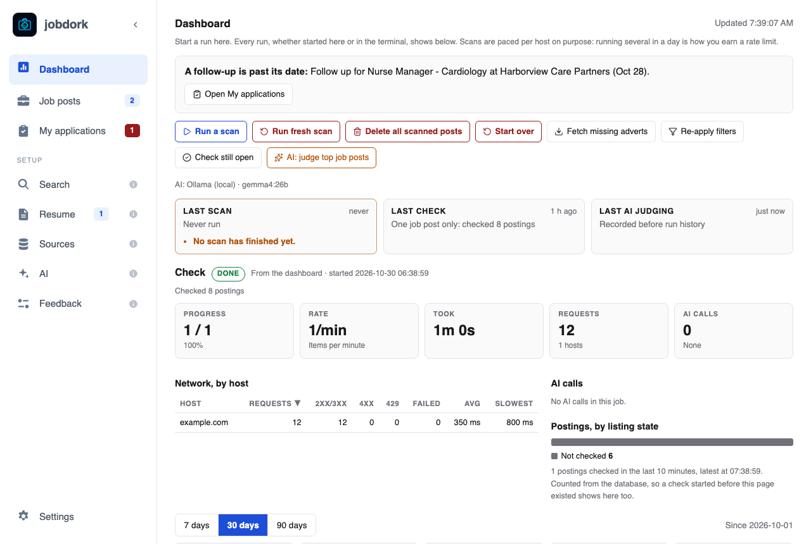
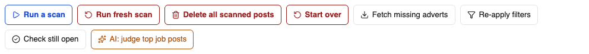
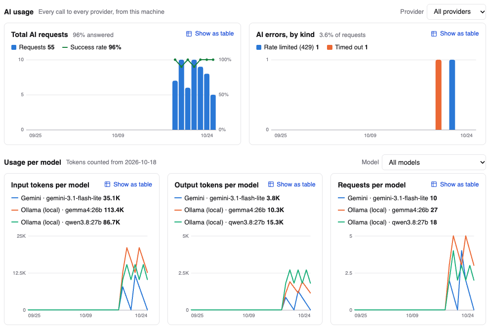

# The Dashboard

The Dashboard is where you start a scan and the other jobs jobdork runs, and
where you see how they went. Every run shows here, whether you started it
here, from a schedule or from a terminal.

## The buttons

| Button | What it does |
|---|---|
| **Run a scan** | Reads every source for new job posts and checks them against your rules. Posts you have seen before are updated, not repeated. Once a day is plenty: boards are read slowly on purpose, and scanning more often gets you blocked for a while |
| **Run fresh scan** | *Red: deletes.* Deletes every job post scans found (with its status, notes and AI verdict, including posts you applied to), then scans from nothing. The database is backed up first, and you confirm the number before anything goes |
| **Delete all scanned posts** | *Red: deletes.* The same delete, without a scan after it |
| **Start over** | *Red: deletes.* Deletes everything: settings, job posts, your uploaded resume, documents and keys. Then setup opens from the start. You see exactly what goes, then confirm with **Delete everything and start setup**, or **Cancel** |
| **Fetch missing adverts** | Some sources send only a short summary. This fetches the full advert from the posting page, so the rules and the scores can read it |
| **Re-apply filters** | Checks every stored post against your current [Search](search.md) settings again. Changing a setting does this by itself; this is for when you want to be sure |
| **Check still open** | Asks each posting whether the job is still up, and closes the ones that are gone (see [listing tags](statuses.md#is-it-still-open)) |
| **AI: judge top job posts** | The AI reads your best-scored posts against your resume and gives each an [AI score](scores.md#ai-the-models-opinion). Needs an AI on the [AI page](ai.md). Orange buttons use the AI, which may cost money with a paid provider |

While a job runs, a progress line shows under the buttons; only one runs at
a time. A yellow or red box under them says what went wrong, if anything did:
a source that returned nothing, a scan that never finished, or a last scan
over 15 days old.

After a scan, jobdork may offer to remove posts that are old (*risky*,
*stale* or *ghost*, see [age tags](statuses.md#how-old-a-post-is)) that you
have not acted on. **Not now** keeps them.

## A run in detail

Under the buttons, a card for the last run of each kind (**Last scan**,
**Last check**, **Last AI judging**); pick one to show it below. Then that
run in full:

- **Progress**, **Rate**, **Time left** (or **Took**, once it ends),
  **Requests** and **AI calls**, as tiles.
- **Outcomes**: what the run counted: posts kept and dropped, verdicts given.
- **Network, by host**: each website read, how many requests, and how many
  were refused or slow.
- **AI calls**: each model, how many calls and how long they took.
- **Postings, by listing state**: how many posts are still up, gone or
  unknown.

## The numbers

Below the run, the weeks behind it. Pick **7 days**, **30 days** or **90 days** to see that period.

| Tile | Means |
|---|---|
| **Runs** | How many scans, checks and AI runs there were |
| **Errored runs** | How many failed, died or were stopped |
| **AI calls** | How many times the AI was asked, and how many of those failed |
| **P50 AI latency** | How long an AI answer usually takes (P50 is the middle; P95 is a slow one) |
| **Hallucination** | Of the facts the AI wrote, the share it could not back up from your resume or the advert. Lower is better: green at 5% or under, amber to 10%, red above, with the words beside it. *Coverage* is how much of the AI's writing was checked ([why](ai.md#the-hallucination-check)) |

The charts below them:

- **Runs by tool, over time**: scans, checks, AI judging, AI writing and the
  rest, day by day.
- **Hallucination, over time**: claims not supported, by kind of writing
  (**By kind**) or by AI model (**By model**), over the same green, amber
  and red bands.
- **Feedback on AI output, per day**: your thumbs up and down on AI
  writing ([how to rate it](job-window.md#rate-the-ai)).

**Show as table** turns any chart into the numbers.

### AI usage

Every call jobdork made to an AI model, local or on your keys, in the
period chosen above. **Provider** narrows all of it to one provider.

- **Total AI requests**: calls per day, and the share answered as a line.
- **AI errors, by kind**: the calls that failed, per day: rate limited
  (429), key refused, provider error (5xx), timed out, could not reach,
  an answer cut off at its length limit, an answer that was not JSON, and
  so on. A provider busy for a moment (502, 503, 504) is asked twice more,
  a few seconds apart, and only counts as an error if all three fail.
- **Usage per model**, one line per model; **Model** shows one:
  - **Input tokens per model**: what was sent: the prompt, the advert,
    your resume.
  - **Output tokens per model**: what the model wrote, its thinking
    included.
  - **Requests per model**: how many times each was asked.

Tokens are as each provider counted them, so they are what a paid key is
billed by. Calls made before jobdork counted tokens show requests but no
tokens.

## Log and history

At the bottom:

- **Log**: what the run printed, line by line.
- **Warnings and errors**: the last 7 days' problems, from every run and
  from the app itself. Pick a line to show that run. These are also what the
  [Feedback](feedback.md) page offers to send.
- **All runs**: every run; pick one to show it above.
