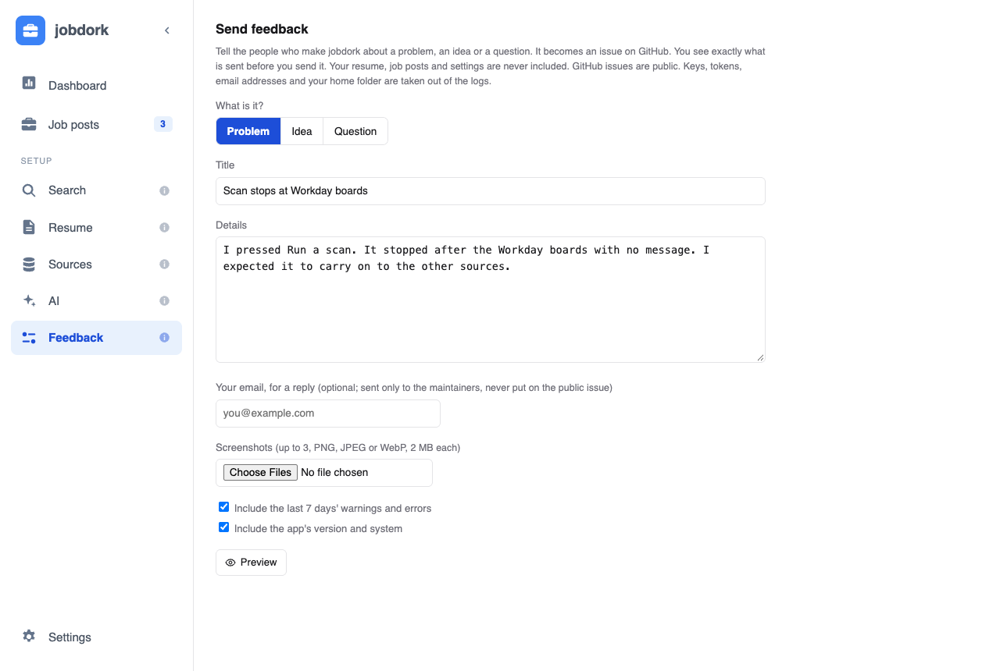
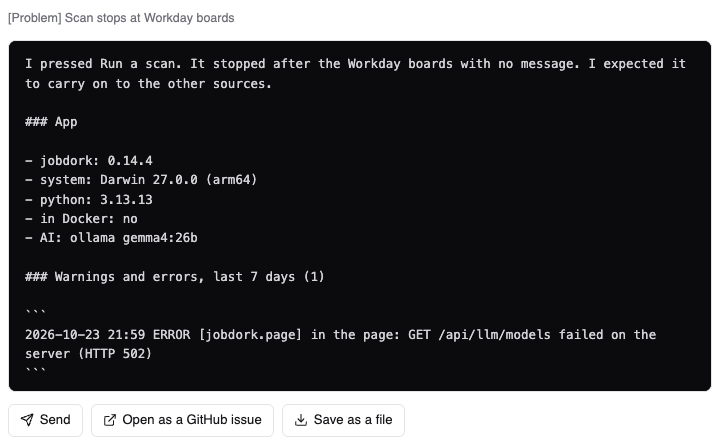

# Sending feedback

Found a problem, have an idea, or a question? The **Feedback** page (**Send
feedback**) sends
it to the people who make jobdork. It becomes an issue on the project's
GitHub page, where you can follow it.

## Writing it

1. **What is it?** **Problem**, **Idea** or **Question**.
2. **Title**: one line, like "Scan stops at Workday boards".
3. **Details**: for a problem, *what you did, what you expected, and what
   happened instead*. The more exact, the faster it is fixed.
4. **Your email, for a reply** (optional): sent only to the maintainers,
   never shown on the public issue.
5. **Screenshots** (optional): up to 3 pictures, PNG, JPEG or WebP, 2 MB
   each. A picture of the problem often says more than the details.
6. **Include the last 7 days' warnings and errors** and **Include the
   app's version and system**: both ticked by default, and usually what a
   problem needs to be found.

!!! tip "Taking a screenshot"
    **Mac:** Shift-Command-4, then drag over the part to capture; it lands
    on your Desktop. **Windows:** Windows-Shift-S, then drag; open the
    notification to save it. Then choose it under **Screenshots**.

## Check what will be sent

**Preview** shows exactly what will be sent, before anything goes.

Your resume, job posts and settings are **never** included. Keys, tokens,
email addresses and your home folder are removed from the logs. GitHub
issues are public, so read the preview through.

## Sending it

| Button | What happens |
|---|---|
| **Send** | Sent straight to the maintainers. Nothing to set up, no account needed. It says *Sent. Thank you.*, with **See the issue** to follow it |
| **Open as a GitHub issue** | Opens a new issue on GitHub in your browser, filled in, for you to post yourself. Needs a free GitHub account; screenshots are added there by dragging them in |
| **Save as a file** | Saves the report as a file, to send another way or later |

If **Send** is greyed out, sending is switched off in your copy of jobdork:
use one of the other two.

## Other ways

- **On GitHub**: [open an issue](https://github.com/jessn-dev/jobDork/issues/new)
  yourself, or comment on an existing one.
- **A security problem** (something that could expose your data or someone
  else's): do not post it publicly; follow
  [SECURITY.md](https://github.com/jessn-dev/jobDork/blob/main/SECURITY.md#reporting-a-problem).
