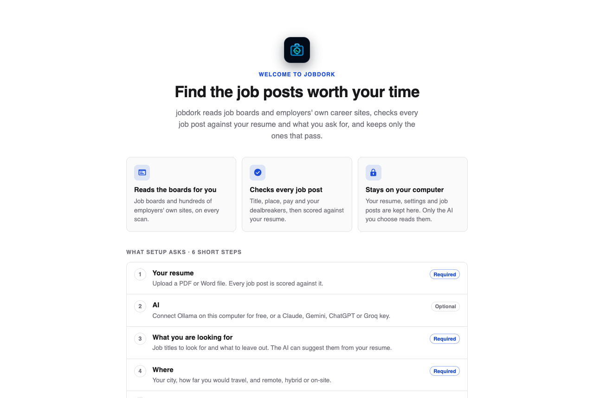

# Getting started

## Install it

| Your computer | How |
|---|---|
| Mac with Apple Silicon (M1 or later) and macOS 12 or newer, Windows 10 or 11 | Download the installer from the [Releases page](https://github.com/jessn-dev/jobDork/releases/latest) and open it. Step by step, including the one-time security warning: [desktop app guide](https://github.com/jessn-dev/jobDork/blob/main/docs/run/desktop.md) |
| Linux, an Intel Mac, or if you prefer Python | [Run it from source](https://github.com/jessn-dev/jobDork/blob/main/docs/run/source.md) |
| A NAS or home server, always on | [Docker](https://github.com/jessn-dev/jobDork/blob/main/docs/run/docker.md) or the [NAS guide](https://github.com/jessn-dev/jobDork/blob/main/docs/run/nas.md) |

Every way works the same once it is open: this guide is about the app
itself. The ways to run it, side by side, are in
[docs/run](https://github.com/jessn-dev/jobDork/blob/main/docs/run/README.md).

## Setup: six short steps

The first time it opens, jobdork shows **Find the job posts worth your
time** and asks a few questions, one per screen: **Continue** goes on,
**Previous** goes back.
Each answer is saved as you go: if you close it halfway, it comes back to
the same step.

On the first page, **Your keys** asks where the keys you enter go: asked
for each time jobdork starts (the default), or kept in your computer's
keychain so you enter each once ([Your keys](settings.md#your-keys)).

1. **Your resume** (required). A PDF, Word (`.docx`), Markdown or text
   file. Every job post is scored against it. It stays on your computer.
2. **AI** (optional). Connect Ollama, a free AI that runs on your own
   computer, or paste a key for Claude, Gemini, ChatGPT or Groq. **Skip for now**
   leaves it for later, on the [AI page](ai.md). jobdork works without it; the
   AI adds a second opinion and writing help.
3. **What you are looking for** (required). Under **Job titles to search
   for**, the titles to find, and any to leave out. With AI set up, it
   suggests titles from your resume. You can also pick the kinds of
   employers and add dealbreakers.
4. **Where** (required). Your country and city are required; the state
   can stay at **Any**. Then how far you would travel, and whether you want
   remote, hybrid or on-site work. **Continue** names the field still empty.
5. **Pay and job sources** (optional). The lowest yearly pay you would
   take: only a post that *states* lower pay is hidden (see
   [the salary floor](search.md#location-work-arrangement-and-pay)). Two
   job sources need a free key, Adzuna and USAJOBS (US federal jobs); add
   them here if you want them, or later on [Sources](sources.md).
   **What will be searched** lists every source the scan will read.
6. **First scan.** One last question, **How old a job post do you still
   want to see?** (older posts are hidden, never deleted; change it any time
   in [Job posts](job-posts.md#finding-a-post)).

Setup ends with **Start the first scan**. A quick scan fills your
[Job posts](job-posts.md) in about a minute; the rest of the employers'
boards are read in the background.

!!! tip "Change anything later"
    Every answer can be changed later on the [Search](search.md),
    [Resume](resume.md), [AI](ai.md) and [Sources](sources.md) pages.
    **Start over** on the [Dashboard](dashboard.md) deletes everything and
    runs setup again.
