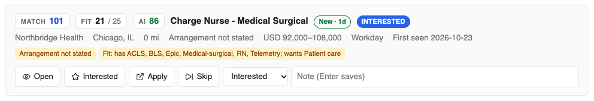
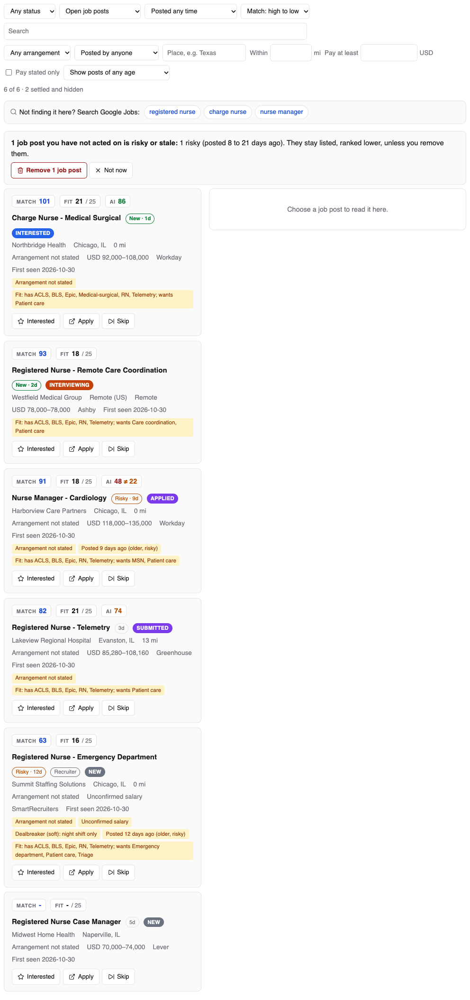
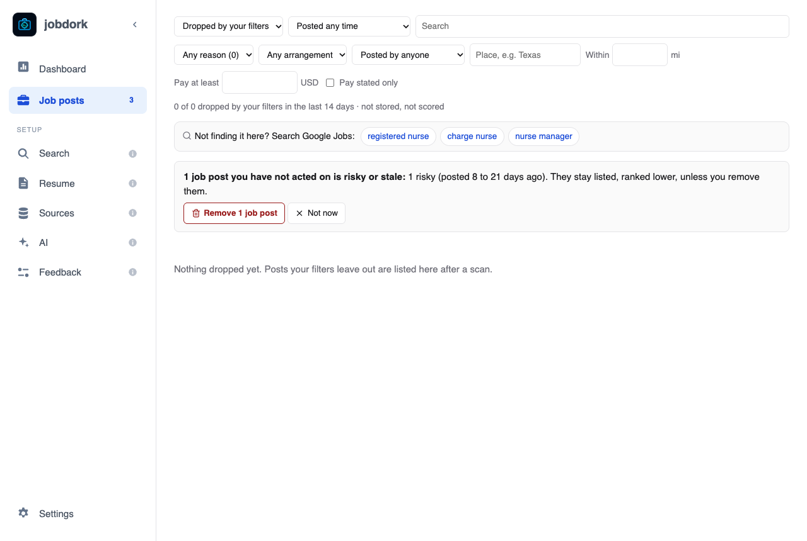

# Job posts

Every job post that passed your rules, best first. What you click here is
remembered: the next scan does not show you the same post as new again.

The number beside **Job posts** in the menu is how many posts are *new*:
ones you have not opened yet.

## One job post

**Top line, left to right:**

- **Match**, **Fit** and **AI**: three scores, explained on
  [Scores explained](scores.md). Point at one (or tap it) to see how it was
  worked out.
- **The job title.** Click it to open the post's
  [window](job-window.md).
- **An age tag**: *New · 1d*, *3d*, *Risky · 9d*, *Stale*, *Ghost*. How
  long ago it was posted, and what that means for your chances
  ([age tags](statuses.md#how-old-a-post-is)).
- **Recruiter**: posted by a recruitment firm for a client, not by the
  employer ([why it matters](statuses.md#recruiter)).
- **The status**, in colour: *new*, *interested*, *applied*…
  ([all of them](statuses.md#statuses)).
- **+1 copy**: the same job was found in more than one place; they are
  shown as one post.

**Second line:** the employer, the place, how far it is from you, remote,
hybrid or on-site (or *Arrangement not stated*), the pay if the post states
it, the source it came from, and when jobdork first saw it.

**Yellow tags** are things worth knowing before you apply: *Arrangement not
stated*, *Unconfirmed salary* (no pay given), a dealbreaker that cost points,
an older post, an Adzuna post missing from the employer's own board, and the **Fit** line (which of the advert's skills you have,
and which you do not). See [tags](statuses.md#yellow-tags).

**May be a job you have already applied to** appears when a post looks like
one you are already pursuing, reached another way (directly and through a
recruiter, or through two recruiters). Applying twice can get you dropped as
a duplicate candidate.

**The buttons:**

| Button | Does |
|---|---|
| **Open** | Opens the post's [window](job-window.md): the whole advert and the AI tools |
| **Interested** | Marks it *interested*: worth applying to |
| **Apply** | Opens the employer's posting in your browser so you can apply there, and marks the post *applied*. If it may be a job you already applied to (see above), it asks first: **Apply anyway?** |
| **Skip** | Marks it *skipped*: not for you. It is hidden from now on |
| The status list | Any [status](statuses.md#statuses) |
| **Note** | Your own note; press Enter to save it ("Phone screen Tuesday 10am") |

## Finding a post

**Top row:**

- **Any status**: only posts with one status.
- **Which posts:** *Open job posts* (the default: everything not settled),
  *New since last scan*, *Including settled* (also the rejected, withdrawn,
  skipped and closed), or *Dropped by your filters* (below).
- **Posted within** 2 days, a week or 3 weeks.
- **Sort:** by Match or Fit, high to low or low to high; or *Unscored only*.
- **Search**: by title or employer.

**Second row**, to narrow the list without changing your settings:
arrangement (remote, hybrid, on-site, not stated), who posted it (the
employer or a recruiter), a place ("Texas"), within a distance, pay at least
an amount, **Pay stated only**, and **Hide posts older than** (this one is
saved as a setting; posts you acted on are always shown). **Clear filters**
resets them.

The line under the filters counts what is shown, how many settled posts are
hidden, and how many older posts are hidden (with *show them*).

**Not here? Search Google Jobs for …**, under the list (or in its place when
nothing matches), names your job titles. Each opens Google's job results in
your browser for that title near your location, or remote if you only want
remote work. It finds posts on sites jobdork cannot read, such as LinkedIn
or JobStreet. Those results stay in Google: to keep one in jobdork, use
**Add a Job Post** on the [Sources page](sources.md). jobdork itself sends
Google nothing; your browser does, when you click.

## Dropped by your filters

Posts a scan found but your rules left out, each with the reason: too far
away, pay below your floor, a title you excluded, a dealbreaker. Pick a
reason in the list beside it to see only those. **Open advert** opens the
posting; **Keep anyway** moves it into your job posts, marked *interested*,
without changing your rules.

## Risky and stale posts

When posts you have not acted on are getting old, a box above the list says
how many. **Remove** deletes them (they stay deleted on later scans);
**Not now** keeps them. A stale post is still listed, just ranked lower: it
may still be worth a try.
