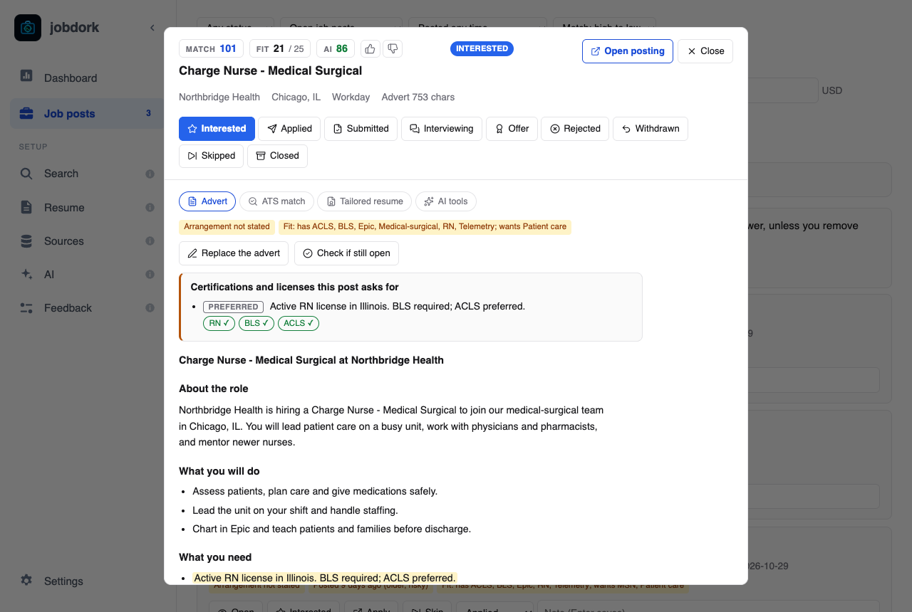
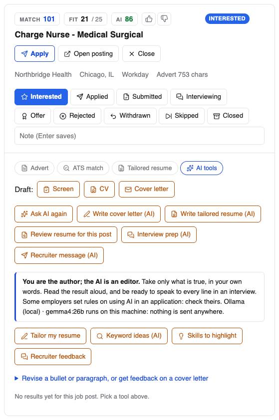
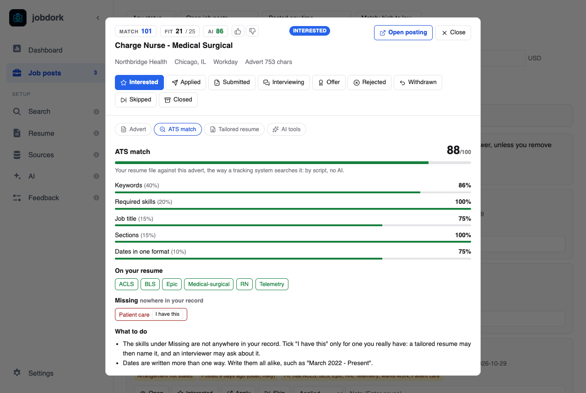

# The job post window

Click a job title, or **Open**, to see one post in full. Opening a new post
marks it *viewed*. On a wide window it opens beside the list on
[Job posts](job-posts.md), with the list still there to choose the next;
on a narrower one, and from other pages (the Resume page's **Job post**), in a
window over the page. Both hold the same things.

## The top

- **Match**, **Fit** and **AI** scores ([explained](scores.md)), and the
  status.
- **Thumbs up and down** beside the AI score:
  was the AI verdict useful? Your answers are counted on the
  [Dashboard](dashboard.md#the-numbers); they are how you can tell whether
  a model is worth keeping.
- **Apply** opens the employer's page in your browser and marks the post
  *applied*, as the card's **Apply** does. **Open posting** only opens it.
  **Close** closes the window, or empties the space beside the list.
- The employer, place, arrangement, source, and how long the stored advert
  is. **Also posted at** lists the other places the same job was found,
  and whether each is still up.
- **The status buttons** ([what each means](statuses.md#statuses)). The
  coloured one is the current status. Under them, your **Note** on the post
  (Enter saves), the same one the card has.

## Advert

The whole job advert, with:

- **Yellow tags**: what to know before you apply
  ([tags](statuses.md#yellow-tags)).
- **On the employer's own board?** For a post from Adzuna, Himalayas,
  Arbeitnow or Kalibrr: what the last scan found on the employer's own board
  (on it, not on it, read only partly, or not read). **Check the employer's
  own board** asks that board now, for this job's title, and says whether it
  is there, with a link if it is. Useful when the scan could not tell, or
  before you apply.
- **Certifications and licenses this post asks for**: each line of the
  advert that asks for one, marked *required* or *preferred*, and a tick for
  the ones you have (from your resume, or your list on
  [Search](search.md#your-certifications-and-licenses)).
- **Paste the full advert** (or **Replace the advert**): some sources send
  only a summary. Open the posting, copy the whole description, paste it and
  **Save and re-screen**: the rules and scores read it at once.
- **Check if still open**: asks the posting now
  ([listing tags](statuses.md#is-it-still-open)).

## AI tools

Everything the AI does for one post is on the **AI tools** tab. Orange
buttons use the AI model from the [AI page](ai.md): free with a local model,
paid by the word with Anthropic, Gemini, OpenAI or Groq.

!!! note "You are the author; the AI is an editor"
    Take only what is true, in your own words. Read the result aloud, and
    be ready to speak to every line in an interview. Some employers set
    rules on using AI in an application: check theirs. With a hosted model,
    your email, phone number and profile links are removed before anything
    is sent.

### ATS match

The **ATS match** tab scores your resume file against this advert the way
an applicant tracking system searches it, out of 100, by script and with
no AI (the parts and weights follow
[Resume Matcher](https://github.com/srbhr/resume-matcher)'s):

| Part | Weight | What it measures |
|---|---|---|
| Keywords | 40% | The advert's skills your resume names |
| Required skills | 20% | The same, of the skills under the advert's *Requirements* or *Qualifications* (the whole advert when it has no such part) |
| Job title | 15% | The post's title at the top of your resume (100), in its summary (75), or some of its words at the top (up to 50) |
| Sections | 15% | An email or phone, and the summary, experience, education and skills headings |
| Dates in one format | 10% | How many of your dates are written the same way |

A part that cannot be judged is left out and the rest weighed to 100. The
skills come from the same list as Fit, and only those in your field count.

Below the score, the advert's skills in three groups:

- **On your resume**.
- **Safe to add**: in your projects, education or confirmed skills on the
  Resume page, but not in your resume file. A tailored resume for this post
  can name them.
- **Missing**: nowhere in your record. **I have this** adds one to your
  confirmed skills: from then on it counts as part of your record, so Fit
  scores count it (job posts are re-scored) and a tailored resume may name
  it. Tick it only for a skill you really have; an interviewer may ask.
  **take back** removes one.

**What to do** lists the changes that would raise the score.

### The main buttons

| Button | What you get |
|---|---|
| **Ask AI** / **Ask AI again** | The AI's verdict on this post: a [score](scores.md#ai-the-models-opinion), a summary, and the reasons for and against |
| **Write cover letter (AI)** | A cover letter from your resume and this advert. It opens in a new **Cover letter** tab, and is listed on the [Resume](resume.md#cover-letters) page |
| **Write tailored resume (AI)** | Your resume rewritten for this advert, as a PDF and a Word file named `FirstName_LastName_JobTitle_Resume`, in a plain layout that applicant tracking systems read well ([the layout](#the-tailored-resume)). It opens in a **Tailored resume** tab. Your contact line is copied from your resume, never written by the AI, and any employer, school, skill, certification or award your resume does not name is left out and listed |
| **Interview prep (AI)** | Ready for the interview: [what it gives](#interview-prep). Opens in an **Interview prep** tab |
| **Recruiter message (AI)** | A short message to a recruiter or hiring manager: [how it is written](#recruiter-message). Opens in a **Recruiter message** tab |
| **Review resume for this post** | What to change in your resume for this post, each point quoting the line it is about, and what the advert asks for that your resume does not show. Opens in a **Resume review** tab |

### Interview prep

From your resume, your Resume page entries and this advert:

- **Why you fit**: three to five points where your resume meets what the
  advert asks for.
- **Questions about your resume**: five to eight an interviewer is likely to
  ask, each with what it tests and answer points from your resume.
- **Follow-ups on your work**: three to six deeper ones about a job or
  project you list (what was hard, what you would change, how a result was
  measured).
- **Gaps to prepare**: three to five things the advert wants that your
  resume does not show, why they may come up, and how to answer honestly.
  A gap is never written as something you have: the **gaps not claimed**
  check is READ if one reads that way.
- **Talking points**: five to eight lines to work into your answers.

What it says about you (the fit, the answer points, the talking points) gets
the hallucination check and the figures check, as a letter does. Saved as
`interview-prep-ai.md` in the job's folder.

### Recruiter message

A message of 70 to 100 words for LinkedIn or an email: its first sentence
names something from the advert (never "I'm reaching out"), one sentence on
your strongest match with a figure only if your resume has one, and a small
ask ("Worth a quick chat?"). No "excited" or "passionate", no greeting, no
placeholders. It gets the same checks as a letter, and a **word count**
check. **Copy message** copies it: jobdork never sends anything; paste it
yourself. Saved as `recruiter-message-ai.md`.

Both follow Resume Matcher's
([srbhr/resume-matcher](https://github.com/srbhr/resume-matcher)) interview
prep and outreach message, rewritten with jobdork's rules.

### Editing help

| Button | What you get |
|---|---|
| **Tailor my resume** | Suggested edits, not a new resume: rewordings of your lines (tick the ones you want), which lines to move up, and a skills line from skills you have that the advert asks for. An edit that adds a number you never wrote is left unticked, in red. **Download tailored resume** gives your resume with the ticked edits |
| **Keyword ideas (AI)** | The ten words the AI expects an applicant tracking system to look for in this advert, each marked found or missing in your resume. The [ATS match](#ats-match) tab scores the same advert by script, for free; the AI can name terms beyond the skills list it uses. (Called **ATS keywords** before 0.16.1) |
| **Skills to highlight** | The advert's three most important skills, the three things you did that best show them, and strong verbs for the role |
| **Recruiter feedback** | The AI reads your resume as this post's recruiter would: strengths and gaps |

Under **Revise a bullet or paragraph, or get feedback on a cover letter**,
paste text of your own:

- **Revise: 5 versions**: five rewordings of one bullet or paragraph, fitted
  to this post, with no new facts.
- **Recruiter feedback on this letter**: a recruiter's view of a whole
  cover letter.

Results stay under the tab, each with the model that wrote it and when; a revision has **Copy** beside each version.

### Drafts through Claude Code

**Draft: Screen, CV, Cover letter** use the `claude` command-line tool, a
separate program from the AI page (installed with
[Claude Code](https://claude.com/claude-code)). Without it these buttons are
greyed out and the rest still works.

- **Screen**: is this worth applying to? A short, cheap read of the advert
  that flags travel, title mismatches and pay problems before you spend
  time on a CV.
- **CV** and **Cover letter**: drafts saved in your documents folder.

### Every result is checked

Before you see anything the AI wrote, jobdork checks it:

- **The hallucination check**: the text is split into single facts and each
  is looked up in your resume and the advert. A fact found in neither is
  flagged: struck out in a verdict, listed with a letter. *"Ten years of
  Java"* where your resume says ten years in total does not reach an
  employer unread. [More](ai.md#the-hallucination-check)
- **Signs of AI writing**: stock phrases ("spearheaded", "leveraged"),
  long dashes, "not X but Y". Each one left is named so you can fix it.
- **Figures**: any number or "large team" in a draft that is not in your
  resume.

In a document's tab, each check shows **ok** or **READ**: READ means look at
it before you send anything. The thumbs on a document say whether it helped.
**Open PDF** and **Download PDF** are on resumes and CVs, and **Download
Word** gives the same resume as a `.docx` to edit in Word, Pages or Google
Docs before you send it.

### The tailored resume

Laid out like Indeed's free resume template, one column:

- your name, then *Phone | Email | City, State*, then your website or
  LinkedIn, centred;
- **Professional summary**, **Experience**, **Skills**, **Education**,
  **Certifications**, then **Awards & volunteer work**, each left out when
  your resume has nothing for it. A student's Education comes right after
  the summary, and projects go where your career stage puts them;
- each job as its title with the dates at the right margin, then
  *Company, City*, then its bullets; skills separated by `|`.

Its length follows [Indeed's advice](https://www.indeed.com/career-advice/resumes-cover-letters/how-long-should-a-resume-be):
one page for up to ten years of experience, two after that, and three only
past 25 years or for academic and medical jobs. Jobs that ended more than
15 years ago are left out (unless it is the only one), the newest job keeps
up to seven bullets and older ones fewer, and when it still runs over, an
older job's last bullets go first. The **page count** check says how many
pages it fills and lists everything left out to fit, so you can put back
what matters by hand in the Word file. Arial at 11 points, 0.7 inch margins,
US Letter.
