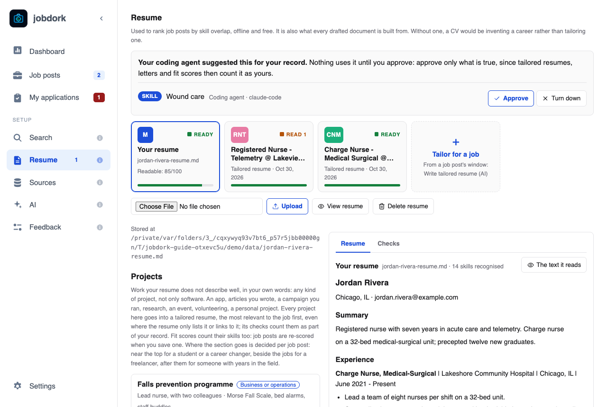

# Resume

Your resume is what every job post is scored against
([Fit](scores.md#fit-your-skills-against-the-adverts)), and what every cover
letter and tailored resume is built from. It stays on your computer.

## Your resume

**Choose File**, then **Upload**: a PDF, Word (`.docx`), Markdown (`.md`) or
text file. A bar under the button shows the file going up, then keeps
moving while jobdork reads it; a long PDF can take a few seconds. Uploading
a new one replaces the old, and every job post is re-scored.

- **View resume** shows it, and under *The text the fit score and the AI
  read*, exactly what jobdork could read from it, with the skills it found.
  If something is missing there, the file's layout hid it (usually a table,
  columns or a text box): applicant tracking systems will miss it too.
  **Download original** gives you your file back.
- **Delete resume** removes it from jobdork.

## Projects

Work your resume does not describe well, in your own words: any kind of
project, not only software. An app, articles you wrote, a campaign you ran,
research, an event, volunteering, a personal project.

**Add a project** asks for a name, the kind, your part in it, the tools or
methods, a link, and four short answers (the STAR method interviewers use):

- **Situation**: what was the context or the problem?
- **Task**: what were you responsible for?
- **Action**: what did you do, and how?
- **Result**: what changed because of it? A number makes it believable.

Every project goes into a tailored resume (the most relevant first) and
counts toward Fit. Where the section goes is decided per job post: near the
top for a student or a career changer, after the jobs for someone with years
in the field. **Save project** keeps it; **Edit** and **Delete** are on each one.

## Education

A degree, diploma, certificate or course your resume does not show yet: one
you finished since you wrote it, or are studying for now ("Expected May
2027"). **Save education** keeps it. It goes under Education in a tailored resume, and job posts are
re-scored when you save one.

## Resume review

**Review my resume** has the AI read your resume and list what to fix, each
point quoting the line it is about. A point that quotes something not in
your resume is dropped, so it cannot invent problems. To compare your resume
with one job, use **Review resume for this post** in that post's
[window](job-window.md#the-four-main-buttons).

## Cover letters

Every cover letter written for a job post, with the post, the employer and
when. **View** opens one (with **Download**); **Delete** removes the file and
its text at once. Write one from a post's window with **Write cover letter
(AI)**.

!!! info "Where the files go"
    Letters and tailored resumes are saved in `Documents/job-applications`,
    one folder per job (in Docker, inside the data folder).
    **Settings → Where your files are** opens it.
