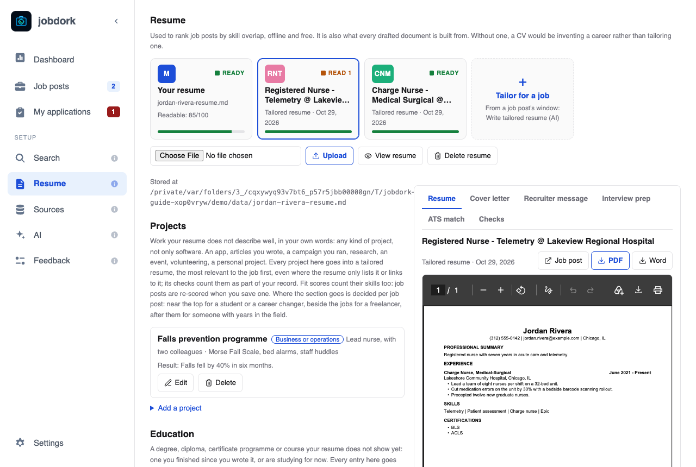
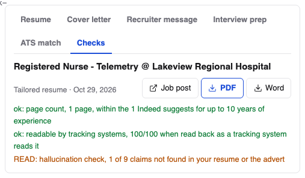
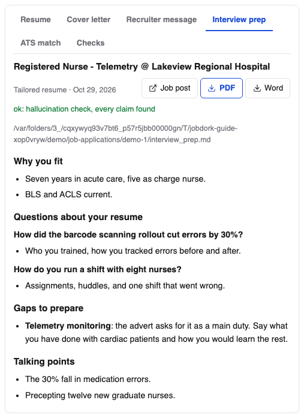

# Resume

Your resume is what every job post is scored against
([Fit](scores.md#fit-your-skills-against-the-adverts)), and what every cover
letter and tailored resume is built from. It stays on your computer.

## Your resumes, as cards

Across the top, a card for each resume:

- **Your resume** (M): the file you uploaded, *Ready* once it is read, with
  its readability score as a bar ([below](#how-a-tracking-system-reads-it)).
- **One card per tailored resume and CV**, newest first: the job post's
  initials, its title and employer, when it was written, and *Ready* when
  every check passed or *Read 1* (2, 3…) for the checks to look at before
  you send it. The bar is how a tracking system reads it.
- **Tailor for a job** opens Job posts: a tailored resume is written from a
  job post's window, with **Write tailored resume (AI)**.

Click a card to see it on the right. **Resume** shows the document (a PDF
as it will print), **Checks** shows its checks: for your own resume, how a
tracking system reads it; for a tailored one, every check its tab shows.
Your resume's preview has **The text it reads**: what the fit score and the
AI were given from the file.
A tailored resume's preview has **Job post** (its window), **PDF** and
**Word**. The preview takes the right side of the page, as wide as the
window allows and as tall as the window, so a page reads at full size. On a
narrow window it moves above the rest.

A tailored resume's preview also has a tab for each of its job post's other
documents, so everything for one application is in one place: **Cover
letter**, **Recruiter message** (with **Copy message**), **Interview prep**,
**Resume review** once you have one, and the post's **ATS match** (the same
as on [its window](job-window.md#ats-match), **I have this** included). One
not written yet says so, with **Open AI tools**: the job post's window, where
it is written. Choosing another tailored card keeps the tab, so you can
compare, say, two cover letters.

## Your resume

**Choose File**, then **Upload**: a PDF, Word (`.docx`), Markdown (`.md`) or
text file. A bar under the button shows the file going up, then keeps
moving while jobdork reads it; a long PDF can take a few seconds. Uploading
a new one replaces the old, and every job post is re-scored. Under the
button, *Stored at* gives the full path of jobdork's copy on your computer
(your own file is left where it was).

### How a tracking system reads it

**Checks**, on your resume's card, looks at the file the way an applicant
tracking system's text reader does, on your computer, with no AI, and
gives a score out of 100. Each problem says what to do:

| Check | What trips a tracking system |
|---|---|
| Text a computer can read | A scan or a picture of a resume: nothing to read |
| Letters come out as letters | A font that does not say which letters its shapes are, or letters spaced apart ("J O H N") |
| No page is a picture | A page that is mostly an image |
| One column | Two columns, read across line by line and mixed (dates at the right margin are fine) |
| No tables, no text boxes | Word tables and text boxes, often skipped or scrambled |
| Nothing only in the page header or footer | Your contact details in a header, which many systems skip |
| Few pictures | A photo, icons or skill bars: anything they say is lost |
| Length | Over two pages |
| Email and phone near the top | Contact details missing, or only far down the page |
| Standard section headings | No Experience, Education or Skills heading, or one split by a large first letter ("E xperience") |
| Dates, in one format | No dates, or "March 2022" in one place and "03/2022" in another |

A failed check costs 30, 12 or 4 points by how much it matters, a warning
half that. A Markdown or text file has no layout, so only the content is
checked. Every tailored resume jobdork writes is checked the same way (the
**readable by tracking systems** check in its tab), and is laid out to pass.
The checks follow [Resume Matcher](https://github.com/srbhr/resume-matcher)'s.

### How its lines are written

Under it, **How its lines are written** reads your resume's bullets as a
recruiter does, also with no AI, and scores them out of 100:

| Rule | What it means | Costs a line |
|---|---|---|
| **Starts by saying you were near the work** | "Responsible for", "Helped with", "Assisted", "Worked on", "Involved in": say what you did instead ("Led", "Built", "Cut") | 40 |
| **Written in the first person** | "I", "my", "me" | 10 |
| **Over 35 words** | More than two lines | 10 |
| **Same first word as other bullets of this job** | Three or more bullets of one job starting alike | 10 |
| **No figure** | No number, where a result could be counted | 5 |

Each rule is shown once, with how many lines it found and three of them.
A PDF's bullet marks are usually drawn rather than written, so from a PDF
the lines of your Experience section are read as its bullets. Only English
is scored. A tailored resume is told the same rules, and its tab has a
**resume writing** check that is READ when a bullet starts by saying you
were near the work; "no figure" stays a note, since a figure may only come
from your resume.

- **View resume** shows it, and under *The text the fit score and the AI
  read*, exactly what jobdork could read from it, with the skills it found.
  If something is missing there, the file's layout hid it (usually a table,
  columns or a text box): applicant tracking systems will miss it too.
  **Download original** gives you your file back.
- **Delete resume** removes it from jobdork.

## Projects

Work your resume does not describe well, in your own words: any kind of
project, not only software. An app, articles you wrote, a campaign you ran,
research, an event, volunteering, a personal project.

**Add a project** asks for a name, the kind, your part in it, the tools or
methods, a link, and four short answers (the STAR method interviewers use):

- **Situation**: what was the context or the problem?
- **Task**: what were you responsible for?
- **Action**: what did you do, and how?
- **Result**: what changed because of it? A number makes it believable.

Every project goes into a tailored resume (the most relevant first) and
counts toward Fit. Where the section goes is decided per job post: near the
top for a student or a career changer, after the jobs for someone with years
in the field. **Save project** keeps it; **Edit** and **Delete** are on each one.

## Education

A degree, diploma, certificate or course your resume does not show yet: one
you finished since you wrote it, or are studying for now ("Expected May
2027"). **Save education** keeps it. It goes under Education in a tailored resume, and job posts are
re-scored when you save one.

## Resume review

**Review my resume** has the AI read your resume and list what to fix, each
point quoting the line it is about. A point that quotes something not in
your resume is dropped, so it cannot invent problems. To compare your resume
with one job, use **Review resume for this post** in that post's
[window](job-window.md#the-main-buttons).

## Cover letters

Every cover letter written for a job post, with the post, the employer and
when. **View** opens one (with **Download**); **Delete** removes the file and
its text at once. Write one from a post's window with **Write cover letter
(AI)**.

!!! info "Where the files go"
    Letters and tailored resumes are saved in `Documents/job-applications`,
    one folder per job (in Docker, inside the data folder).
    **Settings → Where your files are** opens it.
