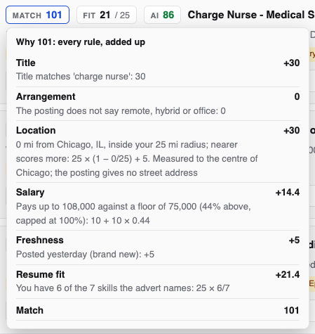
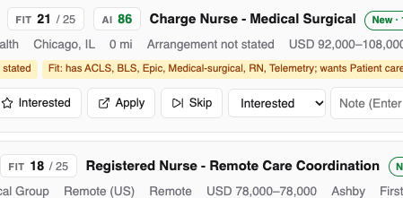
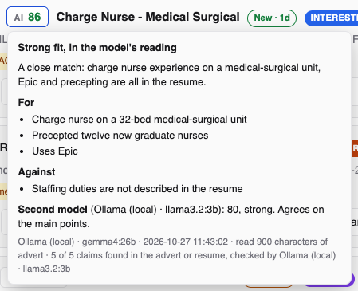

# Scores explained: Match, Fit and AI

Every job post can carry three numbers. They answer different questions,
and none of them hides a post: your rules on [Search](search.md) decide what
is kept, and the scores only decide the order.

| Score | Answers | Made by | Costs |
|---|---|---|---|
| **Match** | How well does the post fit everything you asked for? | jobdork's own rules, the same every time | Nothing |
| **Fit** | How much of what the advert asks for is on your resume? | Matching skills, by script | Nothing |
| **AI** | Would someone reading both the advert and your resume call this a good fit? | The AI model on the [AI page](ai.md) | Time, or money with a paid provider |

Point at a score (or tap it) to see exactly how it was reached.

## Match: everything you asked for, added up

Match is points, not a percentage, so it can go above 100. Each rule adds
its share:

| Rule | Points |
|---|---|
| The title matches one of yours exactly | 30 (18 for a looser match, the same words in another order) |
| Remote, hybrid or on-site, as you asked | 10 |
| A remote job | 20 |
| Within your radius | 5 to 30; nearer is more (measured from the nearest of your cities) |
| In a state or region you chose, or in one of your cities with *exact* | 25 |
| Pay stated and above your floor | 10 to 20; more headroom is more |
| Pay stated, no floor set | 5 |
| Resume fit (the Fit score, below) | 0 to 25 |
| Posted in the last 2 days | +5 |
| Posted 8 to 21 days ago | −5 |
| Posted over 21 days ago | −15 |
| Each dealbreaker set to *costs 8 points* | −8 |

Nearness is worth only a few points on purpose: a job 24 miles away that
fits is worth more than one next door that does not.

A post that **states no pay** or **no arrangement** is never dropped for it:
it simply gets no points for it, and a tag says so.

## Fit: your skills against the advert's

Fit is out of 25. jobdork finds the skills, tools and certifications the
advert names and counts how many are on your resume, plus the projects and
education you added on the [Resume](resume.md) page.

- **On your resume** (green): skills the advert asks for that you have.
- **Asked for, not on your resume**: worth a look. Sometimes you have
  the skill and the resume does not say so; add it to your resume or a
  project.

No resume, or an advert too short to read, shows **-** (no score), which is
not the same as 0.

## AI: the model's opinion

With an AI set up, it reads the whole advert against your whole resume and
gives a score out of 100 with a word:

| Score | Word |
|---|---|
| 80 and over | **Strong** fit |
| 50 to 79 | **Possible** fit |
| Under 50 | **Weak** fit |

Point at it to read why: a summary, the reasons **For** and **Against**,
and anything it said that is **Not in the advert or resume** (struck out:
the AI got that wrong, see [the hallucination check](ai.md#the-hallucination-check)).

- **?** means the advert or your resume was too thin to judge; it says so
  rather than guess.
- When the model calls something missing that your resume lists ("the
  resume does not mention Linux" over a skills line with Linux), jobdork
  catches it, asks the model to score again knowing it is there, and lists
  it under **For**. The verdict says so, with the first score.
- **≠ 22** after the score means a second model scored it very differently
  (20 points or more apart): **models disagree**. Read the advert yourself.
- The thumbs beside it in the [job post window](job-window.md#rate-the-ai)
  tell the Dashboard whether the verdict helped.

The AI score sits beside Match; it never replaces it or hides a post. Get
one for a post with **Ask AI** in its window, or for your best posts at once
with **AI: judge top job posts** on the [Dashboard](dashboard.md).
