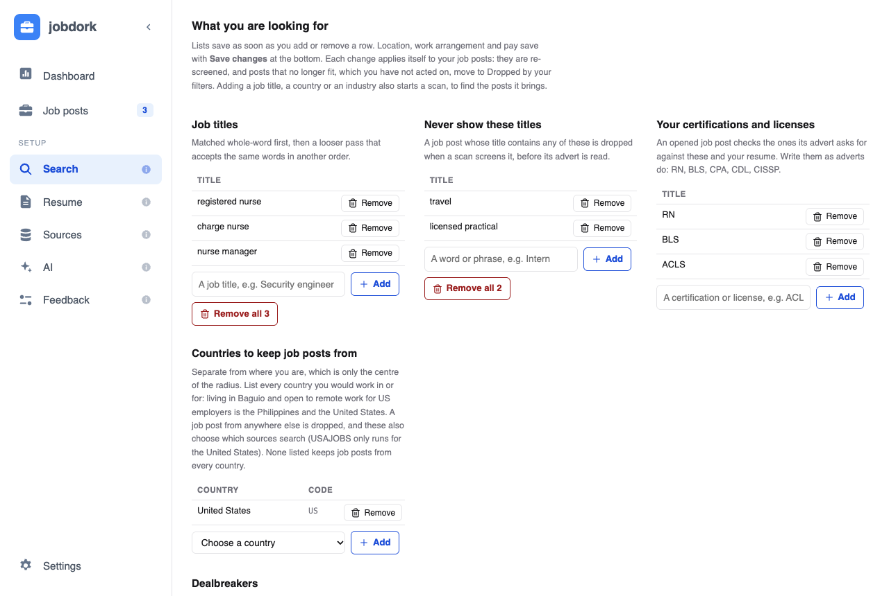
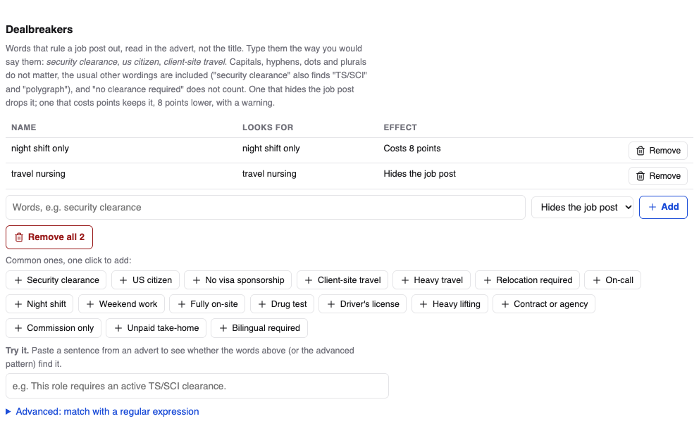

# Search: what you are looking for

The **Search** page holds your rules. A scan keeps a job post only when it
passes them; the [scores](scores.md) then put the best first.

**Saving.** Lists (titles, countries, dealbreakers…) save as soon as you add
or remove a row. Location, work arrangement and pay save with **Save
changes** at the bottom. Every change re-checks your stored job posts at
once: posts that no longer fit, and that you have not acted on, move to
[Dropped by your filters](job-posts.md#dropped-by-your-filters). Adding a job
title, a country or an industry also starts a scan, to find the posts it
brings.

## Job titles

The titles to look for, such as *registered nurse*, *store manager*,
*accountant*. A post's title must match one. Whole words first ("charge
nurse" finds "Charge Nurse - ICU"), then a looser pass that accepts the
same words in another order ("nurse, charge"). **Add** one at a time;
**Remove all** clears the list.

Several short titles find more than one long one: *registered nurse* and
*charge nurse* rather than *registered nurse or charge nurse in a hospital*.

## Never show these titles

Words that drop a post when its title contains them: *intern*, *travel*,
*senior* if you are not. The advert is not read for these, only the title.

## Your certifications and licenses

The ones you hold, written the way adverts write them: *RN*, *BLS*, *CPA*,
*CDL*, *CISSP*. When you open a post, its
[certifications box](job-window.md#advert) ticks the ones you have, from
this list and your resume.

## Countries to keep job posts from

Every country you would work in **or for**. This is separate from where
you live, which is only the centre of your radius: someone living in Baguio
who wants remote work for US employers lists the Philippines *and* the
United States. A post from any other country is dropped. These also choose
which sources search (USAJOBS only runs for the United States). None listed
keeps posts from every country.

## Dealbreakers

Words in the **advert** (not the title) that rule a job out: *security
clearance*, *us citizen*, *night shift only*, *100% travel*. Type them the
way you would say them. Capitals, hyphens, dots and plurals do not matter,
the usual other wordings are included ("security clearance" also finds
"TS/SCI"), and "no clearance required" does not count.

Each one either:

- **Hides the job post**: the post is dropped, and listed under
  *Dropped by your filters* with the reason; or
- **Costs 8 points**: the post is kept, 8 points lower in
  [Match](scores.md#match-everything-you-asked-for-added-up), with a yellow
  warning.

**Common ones, one click to add** offers the usual ones. Several ways of
saying one thing can be separated by commas: *on call, pager duty*.

**Try it**: paste a sentence from an advert to see whether your dealbreakers
catch it, before you rely on them.

**Advanced: match with a regular expression** is for patterns plain words
cannot say, with a table of what each symbol means. Most people never need
it.

## Location, work arrangement and pay

- **Country**, **Region** and **City**: where you are. Start typing the
  city and pick it from the list.
- **Radius**: how far from your city a job's office may be, in miles or
  kilometres (*mi* or *km*). A remote job is kept wherever it is.
- **Arrangements to keep**: remote, hybrid, on-site. None ticked keeps all
  three. A post that says nothing about it is always kept, tagged
  *Arrangement not stated*.
- **Salary floor** and its currency: the lowest yearly pay you would take.
  A post is hidden **only when it states pay and even the top of its range
  is below your floor**. A post that states no pay (most of them, about
  seven in eight) is kept and tagged *Unconfirmed salary*. Hourly and daily
  pay is turned into a yearly figure first ($40 an hour is about $83,000 a
  year). Pay in another currency is never converted, so it never hides a
  post.

**Save changes** saves all of these at once.
