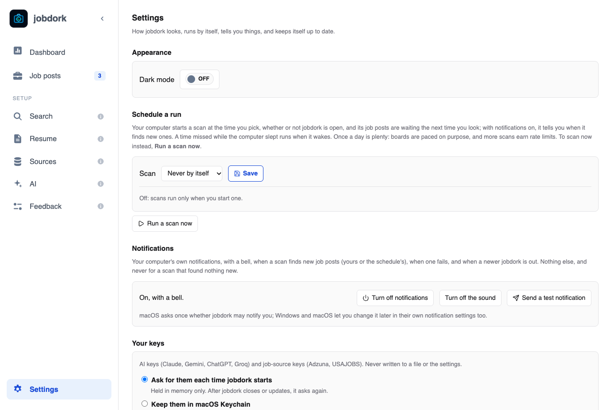

# Settings

The gear at the bottom of the menu: how jobdork looks, runs by itself, tells
you things and keeps itself up to date.

## Appearance

**Dark mode** on or off. Until you choose, it follows your computer's
light or dark setting.

## Schedule a run

Your computer starts a scan at the time you pick, whether or not jobdork is
open, and the new job posts are waiting the next time you look.

- **Scan**: *Never by itself*, *Every day*, *Every weekday* or *Once a
  week* (then pick the day), **at** a time. **Save**.
- A time missed while the computer was asleep runs when it wakes.
- Once a day is plenty: job boards are read slowly on purpose, and more
  scans get you blocked for a while.
- **Run a scan now** starts one at once.

It uses your computer's own scheduler (launchd on a Mac, Task Scheduler on
Windows, cron on Linux). In Docker there is no scheduler inside the
container: use the host's, as the
[Docker guide](https://github.com/jessn-dev/jobDork/blob/main/docs/run/docker.md#scans-that-run-by-themselves)
shows.

## Notifications

Your computer's own notifications, with a bell, when a scan finds new job
posts (yours or the schedule's), when a scan fails, and when a newer
jobdork is out. Never for a scan that found nothing new.

Turn them off, or their sound off, with the buttons here. **Send a test
notification** checks they reach you. (On a Mac the first one asks your
permission; in Docker, the page rings a bell while it is open instead.)

## Your keys

Where AI keys (Claude, Gemini, ChatGPT, Groq) and job-source keys (Adzuna,
USAJOBS) go. Never into a file or the settings.

- **Ask for them each time jobdork starts**: held in memory only. When
  jobdork closes or updates they are gone, and when it starts again a window,
  **Enter your keys**, asks for the ones your AI page and job sources use.
  A key already set in your computer's environment, outside jobdork (such
  as `OPENAI_API_KEY` in a shell profile, or with `launchctl setenv` on a
  Mac), is not asked for: the window names it and the variable, and lets
  you paste another to use instead until jobdork closes.
  **Not now** leaves it until the next start; the AI page and the Sources
  page take them too.
- **Keep them in this computer's keychain** (macOS Keychain, Windows
  Credential Manager, or the Secret Service on Linux): encrypted with your
  login, so you enter each key once. Turning it on keeps the keys you have
  entered so far; turning it off removes the kept copies.
    - **On a Mac**, after each jobdork update the Mac asks once to let jobdork
      use the keychain: choose **Always Allow**. Until you do, a scheduled scan
      runs without the kept keys.
    - **In a container** or on Linux without a Secret Service, there is no
      keychain to keep them in; the page says so. In a container, give keys in
      its environment instead.
- **Forget saved keys** removes every key kept in the keychain. Keys held
  now stay until jobdork closes. **Start over** on the Dashboard and removing
  jobdork ([below](#remove-jobdork-from-this-computer)) also remove them,
  always: kept keys never outlive jobdork on your computer.

Earlier versions (0.15.1 and before) kept Adzuna and USAJOBS keys in a plain
file. The first start of a newer one asks where they go, **Keep them in**
the keychain or **This time only**, and deletes the file either way.

## Updates

Which version you have and whether a newer one is out.

- **Check now** asks at once. When GitHub cannot be reached it says so and
  why (offline, GitHub limiting requests from your network, a certificate
  it could not verify), and offers **Release page** to look yourself.
- **Update** (in the desktop app) opens a window that follows each step:
  asking GitHub for the release, downloading the installer (with how much
  is done), checking it against the release's checksums, checking it was
  built by jobdork's own release workflow (its build attestation), and
  opening it. An installer that fails a check is deleted, not opened. Then
  the window says how to finish:
    - **Mac:** click **Quit jobdork**, drag jobdork onto Applications in the
      Finder window that opened and choose Replace, then open it again.
    - **Windows:** follow the installer; it closes jobdork and offers to open
      the new version.

  If the update cannot finish, the window says why, with **Release page** to
  download it yourself. Your settings and job posts are kept either way.
  Elsewhere than the desktop app, Settings says how to update your copy,
  with **Release page**.
- **Turn off the daily check** stops jobdork asking GitHub once a day. That
  check is one request for the number of the latest release; nothing about
  you is sent ([privacy policy](https://github.com/jessn-dev/jobDork/blob/main/PRIVACY.md)).

## Built-in employer boards

All of the [built-in employer boards](sources.md#built-in-employer-boards)
on or off at once. Choose industries, or switch single boards off, on the
Sources page.

## Where your files are

Buttons that open the folders jobdork keeps things in: settings and the
database, your resume, your letters and resumes, logs and backups. Use them
to back up, move to another computer, or attach a log to a
[feedback report](feedback.md).

## Clean up job posts

Delete old job posts you are not pursuing:

- **Older than** 15 or 30 days, or
- **With status** rejected, withdrawn, skipped or closed.

**Preview** first lists what would go; nothing is deleted until you press
the red button. Posts you applied to, or are interviewing or have an offer
for, are always kept. The database is backed up to `data/backups/` before
every delete, and a deleted post stays deleted: later scans leave it out.

## Remove jobdork from this computer

To take jobdork off your computer cleanly. The scheduled scan, the app
window's storage and any keys kept in your computer's keychain always go.
Of yours, tick what to delete as well; anything not ticked is kept, so a
reinstall finds it:

- **Settings**: what you search for, where, pay, the AI page.
- **Job posts**, with your statuses, notes and AI verdicts, and the backups
  of them.
- **Your resume**.
- **Letters and tailored resumes** jobdork wrote (in Documents, job-applications).
- **Logs**.
- **Downloaded installers** the Update button left in Downloads.

Click **Remove jobdork…**, check the list it shows, then **Yes, remove**. Last,
remove the program itself, as the page says:

- **Mac:** **Quit jobdork**, then drag jobdork from Applications to the Trash.
- **Windows:** use **Settings, Apps, jobdork, Uninstall** instead of this
  page: the uninstaller asks the same questions, and can remove files
  jobdork has open while it runs.
- **Linux:** **Quit jobdork**, then delete the AppImage, or run
  `sudo apt remove jobdork` if you installed the .deb.

From a terminal it is `jobdork uninstall`, which asks about each item, or
`jobdork uninstall --remove jobs,logs` (or `all`). Saved keys go either way.
