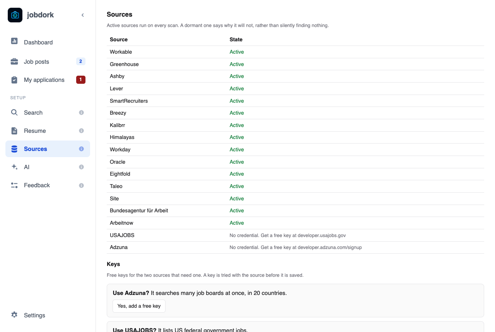

# Sources: where job posts come from

jobdork reads two kinds of places:

- **Job boards searched by keyword**: they take your job titles and answer
  for many employers at once (Workable, Himalayas for remote work, Kalibrr in
  the Philippines and Indonesia, Germany's employment agency, Arbeitnow, and
  with a free key Adzuna and USAJOBS).
- **Employers' own boards**: the career sites employers run on systems such
  as Workday, Greenhouse, Lever or Oracle. One board is one employer, and
  they give the whole advert, which keyword boards often cut short.

Sites like Indeed and LinkedIn are not read: they do not allow programs to
read them.

## The list of sources

Each source and its state. **Active** sources run on every scan. One that
is not says why ("No credential. Get a free key at …", "skipped: only
Philippine and Indonesian postings"), rather than quietly finding nothing.

## Keys

Two sources need a free key: **Adzuna** (many job boards at once, in 20
countries) and **USAJOBS** (US federal government jobs). **Yes, add a free
key** shows where to get one and where to paste it; **Show** shows a saved
key, **Replace** and **Remove** change it. A key is tested with the source
before it is saved, and kept in a file only you can read, never in your
settings.

## Add a job post

Found a post yourself, anywhere? Paste its link and **Add**: it is read into
[Job posts](job-posts.md) like any scanned post, with the whole advert.

- A post on Greenhouse, Lever, Ashby, Breezy, SmartRecruiters, Workday,
  Oracle, Eightfold or Taleo Enterprise comes in whole.
- Any other page is read from what it publishes for search engines, which
  most careers sites do.
- When a page cannot be read (it is drawn by script, or it keeps the post
  behind a login), jobdork says why and opens a form: paste the advert's
  text, with its title, employer and place, and **Add from the text**.

A Greenhouse post on the employer's own site (`?gh_jid=` in the link) can
also be read with its board name, typed in the box beside the link.

## Employer boards

Employers you added. **Their website**, then **Look** to see what jobdork
finds on it, or **Look and add** to add it. A board is read from the
employer's own site, never guessed from their name: board names are rarely
the company name, and a guess can find a different company. Each one shows
how many jobs it has; **Remove** takes it off.

## Built-in employer boards

Hundreds of employers' boards come with jobdork, across industries
(hospitals, banks, retailers, insurers, airlines, government contractors…),
each checked weekly for jobs. A scan reads the ones hiring in your
countries.

- Tick **industries** to read only those (none ticked reads every one).
- Switch **single boards** off.
- More boards make scans longer.

**Settings → Built-in employer boards** switches them all off or on.
