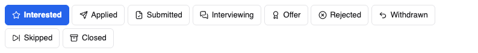

# Statuses and tags

## Statuses

A status is where you are with a job. jobdork sets the first two for you;
the rest are yours. Set one with the buttons on a post
([Job posts](job-posts.md#one-job-post)) or in its
[window](job-window.md).

| Status | Means | Set by |
|---|---|---|
| **new** | Found by a scan; you have not opened it yet | jobdork |
| **viewed** | You opened it, and have not decided | jobdork, when you open it |
| **interested** | Worth applying to | You |
| **applied** | You applied (or started to) | You, or **Apply** |
| **submitted** | The application is in and complete | You |
| **interviewing** | You are talking to them | You |
| **offer** | They made you an offer | You |
| **rejected** | They said no | You |
| **withdrawn** | You pulled out | You |
| **skipped** | Not for you | You, or **Skip** |
| **closed** | The job is gone: filled, or taken down | You, or **Check still open** |

**Settled posts are hidden.** *rejected*, *withdrawn*, *skipped* and
*closed* are done with, so they leave the list. Choose *Including settled*
in [Job posts](job-posts.md#finding-a-post) to see them again.

**Posts you are pursuing are always kept.** *applied*, *submitted*,
*interviewing* and *offer* are never removed by a clean-up, an age limit or
a change to your rules: a decision you made outranks a rule.

**A status belongs to the job, not the link.** When one job is posted in
several places, the copies share one status.

## How old a post is

The age tag beside the title says how long ago the job was posted, by the
employer's own date where there is one:

| Tag | Age | What it means for you | Match |
|---|---|---|---|
| **New · 1d** | 0 to 2 days | Top of the pile: apply now | +5 |
| **5d** | up to a week | When most people apply | 0 |
| **Risky · 12d** | 8 to 21 days | Interviews may have started | −5 |
| **Stale** | over 21 days | May be filled, or a listing reposted by a script | −15 |
| **Ghost** | over 90 days | Almost certainly not a real opening; dropped | |
| **Date unknown** | | The board gives no date | |

Only ghost posts are dropped. A stale post for the job you want most is
still worth a try, so it is marked and ranked lower, never removed unless
you remove it.

## Is it still open?

**Check still open** on the [Dashboard](dashboard.md), or **Check if still
open** in a post's window, asks each posting whether the job is still up.
A tag shows the answer:

| Tag | Means |
|---|---|
| **Still open** | The posting is up (shown in the post's window) |
| **Maybe gone** | It is no longer on the employer's board, or has not been seen for a while |
| **Closed** | The posting says it is closed or is gone; the post is set to *closed* |

When one job is posted in several places, it closes only when every copy
has gone.

## Recruiter

**Recruiter** means a recruitment or staffing firm posted the job for a
client, so the employer may not be named. Point at it to see why jobdork
thinks so. Use *Posted by the employer* or *Posted by a recruiter* in the
[filters](job-posts.md#finding-a-post) to see one kind.

If you apply to the same job directly and through a recruiter (or through
two recruiters), the employer may see you twice and drop you. jobdork warns
you when a post looks like one you are already pursuing.

## Yellow tags

| Tag | Means |
|---|---|
| **Arrangement not stated** | The post does not say remote, hybrid or on-site. It is kept whatever you chose |
| **Unconfirmed salary** | No pay stated. It is kept whatever your floor is |
| **Salary in EUR, floor is USD; not compared** | Pay in another currency is never converted, so it never hides a post |
| **Dealbreaker (soft): …** | One of your [dealbreakers](search.md#dealbreakers) set to *costs 8 points* |
| **Posted 9 days ago (older, risky)** | See [age](#how-old-a-post-is) |
| **Fit: has …; wants …** | Which of the advert's skills you have, and which not ([Fit](scores.md#fit-your-skills-against-the-adverts)) |
| **Advert is only 180 chars, too short to screen** | Only a summary arrived. **Fetch missing adverts**, or paste it in the post's window |
| **States it will not sponsor a visa** | The advert says so. Most say nothing: treat a post without it as unknown, not as sponsoring |
